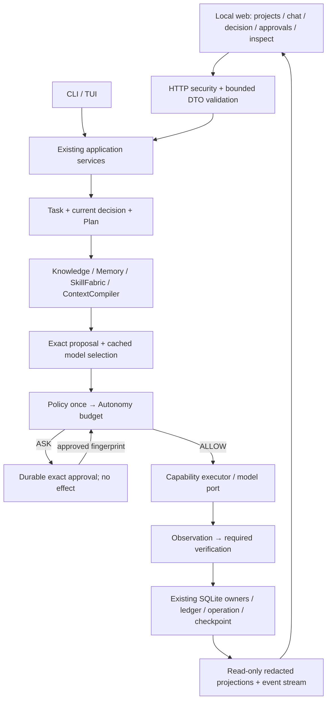

# PAW Beta — Limitations and Release Decision

## Productization audit and web execution contract — 2026-10-05

Repair follow-up: F01 intake/stream persistence and F02 same-process transaction
isolation have working-tree repairs and focused regression evidence in
[the implementation map](IMPLEMENTATION_MAP.md). The FAIL reproductions below
describe the initial baseline, not the repaired code. Overall release remains
`PARTIAL`. Follow-up 2026-10-07: B-18 bounded readiness/recovery and two-approval
CLI satisfy working-tree acceptance (D3: 2262 passed, 3 skipped); B-19 discovery/
payload and web lifecycle/security acceptance remain outstanding. No clean-release
certification or general engineering verification is implied.
F06 follow-up rejects silent provider fallback and stops downstream execution
on model dispatch/provider failure; current proof and remaining usage/discovery/
payload limits are in the map. The B-15 inventory below pins source/test targets.

Baseline: `9fb893e` plus the user's existing `src/paw/knowledge/index.py`
change. That change is preserved. Product release result: `PARTIAL`;
At the initial baseline, two reproduced defects made the concurrent/streaming
acceptance gate `FAIL`; scoped subsequent repairs are recorded above.
This section supersedes the release language in the dated September record
below. It is an audit and implementation handoff, not a new phase or a web
implementation claim. Current-runtime certification, live cloud quality and
an exhaustive security review have not been performed.

### Product being shipped

A single-user, local-first engineering workstation: select a configured project,
analyze/ideate/change/review, inspect research and approvals, execute through
PAW, verify changes, and retain scoped history. CLI and web are clients of the
same application services. The web server runs explicitly in the foreground on
loopback; no daemon, hosted service, multi-user support or new provider is needed.
Training stays experimental and outside the required release gate.

"All existing features" means coverage of supported CLI flows plus bounded
views/actions over existing library capabilities. It does not mean every
Python helper becomes an HTTP endpoint. Experimental capabilities remain
visible with their support level; unavailable actions explain the prerequisite.
Completeness is measured by the parity table, not by a chat screenshot.

### Decision record

Depth: `DEEP`. Problem: usable CLI behavior and many feature-level tests do not
establish an integrated, safe, upgradeable engineering product. HTTP introduces
concurrency, browser-origin attacks and request retry semantics absent in a
single CLI turn. Constraints: one Task/runtime/Policy/SkillFabric/schema owner;
no cloud spend, user-data inspection, new provider, hosting or training in this
audit; preserve current work. Research budget: canonical documents, application
and core boundaries, focused temporary-DB proofs, collection and official web
security guidance; stop once release blockers and falsifiable work packets are
identified. Repository-wide behavioral certification remains a later gate.

Options:

| Option | Benefit | Cost / evidence against |
|---|---|---|
| A. CLI repairs only, defer web | Smallest change; fewer attack surfaces | Does not satisfy the requested product interface or visibility. |
| B. Local HTTP adapter + packaged static UI, shared services (selected) | Reuses async Python, one wheel/process and runtime; staged parity | Requires transport security, lifecycle and concurrent-storage repairs; UI cannot fill missing runtime intelligence. |
| C. Separate frontend/server and hosted job system | Flexible deployment and richer team UX | Adds another deployment/lock/worker lifecycle and tenancy scope not requested. |

Readiness: `READY` for this documentary contract and bounded reproductions.
Production web implementation is `SPIKE_REQUIRED` until B-15..B-19 pass;
each later packet re-establishes `READY` at its revision. Preferred stack for
the spike: optional `web` extra with Starlette/Uvicorn, same-origin packaged
HTML/CSS/JavaScript, fetch-based event streaming. Do not pin versions or modify
`uv.lock` in documentation work; the spike must verify Python 3.12 compatibility,
wheel asset inclusion, static accessibility and transport tests. A JS build
framework can be reconsidered only if the UI complexity justifies another build
and its reproducibility cost. No standalone Sites deployment is implied.

### Findings, repair strategy and release blockers

P0 blocks execution-enabled web; P1 blocks a usable product release; P2 is
bounded maintenance/experimental work. `OBSERVED` is inspection, not a proof
that every path violates the invariant.

| ID / severity | Evidence and consequence | Canonical owner / solution | Falsifiable acceptance |
|---|---|---|---|
| F01 / P0 | `ChatService.send_streaming` omits the cancelled/pending-approval guards in `send`. Temporary-DB proof: send after cancel = `cancelled`; stream = `completed`. | `application/chat.py`: one shared intake and runtime path; stream only transports events. | Cancelled and pending-approval sends/streams create no new Task, call no provider/executor, preserve approval. |
| F02 / P0 | `Database.transaction` uses one connection and shared `_transaction_depth`; overlapping coroutines are treated as nesting. Proof: B returns success; A rolls back; B's row is absent. | `core/storage.py`: explicit task-owned transaction serialization/connection strategy, including writes outside transactions. A plain HTTP per-session lock is insufficient across sessions. | Independent B survives A rollback; no cross-task nesting; cancellation releases ownership and rolls back; close/reopen preserves acknowledged rows. |
| F03 / P0 | Runtime defaults `readiness='READY'`, empty revision/constraint checks. Chat builds no durable decision/Plan. Inspection does not establish fail-closed readiness on all mutation paths. | Runtime + Planner + existing decision persistence: load current durable FINAL decision for mutations; reject missing/mismatched/stale records. Do not invent a readiness store. | Missing decision/default construction cannot write; all five readiness states, exact Task/revision/fingerprint and restart covered. |
| F04 / P0 | `ChatService.open` calls `initialize_all` before task gating; `_select_model_for_proposal` calls router before Policy. Initialization/discovery can do I/O. | ProviderRegistry + runtime/application bootstrap: cache-only selection; discovery/health must be explicit authorized operations. | Counting transport proves DENY/ASK and opening a session cannot trigger unauthorized discovery/network. |
| F05 / P0 | Remote branches inspect a manifest but pass independent `action.metadata['messages']`; manifest absence and final payload binding are not rejected here. | ContextCompiler/privacy + runtime: validate actual serialized outbound payload, task/source identity, hash, freshness and final budget, for complete and stream. | Missing/foreign/stale manifest, secret marker in history, payload substitution and oversized payload => zero remote calls. |
| F06 / P1 | `ModelExecutor._resolve_provider` silently uses stand-in for an unregistered selected provider; runtime catches model exceptions and can continue to capability executor. | Existing executor/router/runtime: typed unavailable/provider failure; stand-in explicitly marked diagnostic, never reasoning success. | Required-model failure/no-route cannot become completed engineering success via mock; local deterministic tool-only flow remains usable. |
| F07 / P1 | Chat uses `max_iterations=1`, `metadata.done=True`, mock executor for ordinary conversation and provider modes local/auto/ollama. E2/E3/library/cloud code presence does not make these daily workflows integrated. | ChatService/application services: profile configuration + actual reconnaissance/decision/Plan/runtime/verification; compose existing provider adapter only. | Foreign-project analyze/idea/review show actual source citations; change has READY, exact approval, diff and required verification; cloud route explicitly configured/gated. |
| F08 / P1 | `SkillFabric.review_skill/approve_skill` accept review fields/state without a mandatory replay/version-hash argument. Candidate index is keyed by name; immutable historical versions/rollback need proof. | SkillFabric with governance as helper, not second registry: prove replay and durable exact-version approval before activation. | Failed/missing/negative replay cannot activate; changed content invalidates approval; approved prior version survives reopen and rollback. |
| F09 / P1 | README/roadmap block E2 while checklist promotes later tracks; E4 marked complete with E4-15..20 open; BETA release evidence is mainly demos/stand-in. | Canonical docs + existing feature inventory: reconcile historical scopes, remove unsupported current claims, link each gate to exact revision commands. | Docs and source parity agree; no item checkbox certifies a track; EN/VI synchronized; contract checks run from tracked checkout. |
| F10 / P1 | Foreign-corpus recall misses persist; latest local-capability record reports min recall 0.25 and unstable cloud reference. | KnowledgeIndex/ContextCompiler + existing measurement runner: finish user's ranking diagnosis, held-out foreign cases; do not tune the oracle. | Required evidence retained at declared thresholds or visibly request more evidence; report embeddings, negatives, corpus identity and per-case failures. |
| F11 / P1 | No tracked web adapter/transport guard, release CI or backup/restore workflow located in inspected paths. Source wheel smoke is not an upgradeable release. | Packaging/CLI/storage/application adapter: clean install, packaged assets, backup + upgrade recovery, reproducible release manifest and CI. | Outside-repo installed wheel covers parity cases; upgrade preserves data; backup restore works; offline tests spend nothing. |
| F12 / P2 | Runtime 2670, skills 1397, router 1413, storage 988, chat 950 lines; E4 evaluation/canary remains open. | Extract cohesive pure helpers only after behavior proofs. Keep E4 read-only/experimental; no rewrite or training expansion. | One `_execute_unit` owner/public contract; no new overlapping managers; E4 cannot enter an unaccepted production route. |

### Feature parity and screens

Support tiers: **supported CLI**, **library / needs integration**,
**experimental**. Backend availability must determine enabled controls.

| Screen / feature | Current entry/owner | Web behavior and missing bridge |
|---|---|---|
| Setup / diagnostics | `paw init/doctor/config/profiles`, config and execution profiles | Safe configuration summary, DB/schema/runtime versions and provider state; secrets redacted; credential values never returned. |
| Projects / context | workspace on ChatService; repo scanner, KnowledgeIndex, ContextCompiler | Server-configured roots, indexing/freshness, source/symbol/test/change maps; no arbitrary client absolute paths. Ingestion bridge needs an explicit bounded action. |
| Sessions / chat | `paw chat`, `paw tui`; ChatStateStore/ChatService | List/create/reopen, history, send/stream, status, approval/resume/cancel; listing and cursors require application projections. |
| Research / decision | E2 reasoning contracts + storage; `PawRuntime.inspect` | Depth, evidence, alternatives, contrary evidence, budget, FINAL/readiness/freshness, clarifications. Show missing records, never synthesize READY in UI. |
| Plan / graph | Planner/TaskScheduler/run_graph; `/plan` currently projects last action | Separate exact operation preview from actual persisted Plan/DAG, dependencies, failure propagation and restart. Requires application bridge. |
| Change / approvals | ApprovalStore, filesystem adapter, `/approve /resume /cancel` | Diff/path/capability/privacy/cost preview; approve exact fingerprint/version, reject/cancel explicitly. Never blanket approval. |
| Verification / artifacts | RuntimeOutcome, verification contracts, `/artifacts` | Separate observed executor result, declared checks and release evaluation; safe bounded artifact text/download. No arbitrary filesystem endpoint or browser shell. |
| Inspect / timeline | `/why /ledger /checkpoint /policy /skills`, beta inspect | Durable event timeline and typed stop reasons; context include/exclude/hash/privacy/token explanations; pagination/redaction. |
| Models / budgets | ModelRouter/ProviderRegistry/ModelExecutor | Cached role manifests, eligibility/escalation, fallback, observed usage vs estimates. Refresh is gated; cloud adapter exists in library but not ChatService modes. |
| Memory / knowledge | MemoryStore/Retriever, knowledge records, `beta inspect memory` | Scoped facts/decisions/provenance, correction and retention controls. Mutations need audited application commands. |
| Skills | SkillFabric and governance/replay helpers; inspect skills | Versions, candidate/review/replay/approve/reject/deprecate/rollback and metrics; writes disabled until F08 proof. |
| Evaluation / adaptation | `paw.bench`, dataset/evaluation modules | Read-only reports with source/config hashes and experimental badge. No training trigger, raw activity capture or implicit cloud spend. |

### Target architecture and cases

#### B-15 source/proof inventory — `9fb893e` + current working tree

This pins existing entry points and regression targets, not full feature
certification. S = supported CLI projection; L = library needing application
integration; E = experimental. A mixed row never means its write operations are
web-ready. Current command results are in IMPLEMENTATION_MAP; old inventory
under `benchmarks/e0/feature_inventory.md` is historical, not current parity.

| Group / tier | Actual entry / source | Existing proof target and unproven bridge |
|---|---|---|
| Setup / S | `cli/__init__.py:doctor/init/config/profiles`; `core/config.py` | `tests/test_phase0.py`, `test_beta_profiles.py`; web safe/redacted configuration commands absent. |
| Projects/context / L | `core/repo_scanner.py`; `knowledge/index.py:KnowledgeIndex`; `core/context_compiler.py` | `test_e1_10_symbol_ownership_contract.py`, `test_e1_11_test_associations_contract.py`, `test_e1_12_recent_changes_contract.py`; foreign retrieval and bounded intake bridge not qualified. |
| Sessions/chat / S | `application/chat.py:ChatService`; CLI chat/TUI | `test_chat_cli_demo.py`, `test_productization_intake.py`; HTTP session listing/cursors/reconnect absent. |
| Research/decision / L | `core/reasoning_contracts.py`; `core/storage.py:record_decision`; `PawRuntime.inspect` | `test_e2_28_decision_persistence.py`, `test_e2_43_inspect_output.py`; generic CRUD/manual readiness does not prove FINAL durable admission (B-18). |
| Plan/graph / L | `core/planner.py:Planner`; `core/task_scheduler.py`; `PawRuntime.run_graph` | `test_planning_contract.py`, `test_phase19_taskgraph_validation.py`, `test_runtime_unit_pipeline.py`; `/plan` is only `chat_inspection.py:plan_projection`, not a DAG editor/service. |
| Changes/approval / S, gated | `core/approval.py:ApprovalStore`; `executors/filesystem.py`; ChatService approve/resume/cancel | `test_chat_cli_demo.py`, `test_local_filesystem_executor.py`, `test_external_effect_reconciliation.py`; exact CLI action is covered, readiness and browser retry/CSRF are not. |
| Verification/artifacts / S+L | `application/chat_inspection.py:artifacts_projection`; `bench/verification.py`; runtime outcome | `test_e0_39_verification_types.py`, `test_chat_cli_demo.py`; check contracts/artifact display are not integrated engineering verification (B-20). |
| Inspect/timeline / S | `application/chat_inspection.py`; `cli/__init__.py:beta_inspect` | `test_chat_cli_demo.py`, `test_beta_demos.py`; bounded/redacted HTTP DTO and pagination absent. |
| Models/budgets / S+L | `core/model_router.py`; `core/model_executor.py`; `core/execution_profile.py` | `test_phase19_model_executor.py`, `test_model_dispatch_fail_closed.py`, `test_phase10_execution_profile.py`; discovery/payload admission and failed usage receipts remain unqualified. |
| Memory/knowledge / S+L | `core/memory.py:MemoryStore/MemoryRetriever`; `knowledge` records; beta inspect memory | `test_phase12_memory_retrieval.py`, `test_phase13_context_builder.py`; HTTP correction/retention authority and project-scoped service absent. |
| Skills / S+L | `core/skills.py:SkillFabric`; `core/skill_governance.py` helpers; inspect skills | `test_e3_transitions.py`, `test_e3_replay.py`, `test_e3_migration_proof.py`; exact replay/hash/version invariants still require F08 proof, not enabled web writes. |
| Evaluation/adaptation / E | `bench/runner.py`, `bench/e1_production.py`, `core/dataset.py` | `test_e0_16_runner.py`, `test_e4_dataset_governance.py`, `test_e4_integration_pack.py`; fixtures/contracts are not trained-artifact acceptance or live cloud quality. No web training command authorized. |

All source names above are relative to `src/paw/` except explicit `tests/`
paths. Unprefixed test filenames refer to the same `tests/` directory. This
inventory marks missing bridges explicitly; B-15 release evidence remains
`PARTIAL` until supported scenarios are linked to installed-wheel parity.

The web shell has three regions: left navigation for Projects, Sessions,
Decisions/Plans, Approvals, Memory/Knowledge, Skills, Models and Diagnostics;
center workspace for chat or the selected view; right inspector for evidence,
context, routing, policy, checks and artifacts. The project/revision, selected
profile, real-model/stand-in state and task stop state remain visible. Selecting
a different project does not silently move an existing session. Approval uses
a dedicated exact-change view, not a generic chat confirmation. Progressive
disclosure keeps the normal chat readable while preserving audit detail.

Usability acceptance: Vietnamese UTF-8 and keyboard input, focus management,
readable contrast, responsive narrow layout, loading/empty/error/unavailable
states, and browser reload/reconnect without lost durable state. A "thinking"
stream is not an authority or required UI product feature; user-facing evidence,
decision summary and uncertainty are enough, without exposing hidden reasoning.

| Case | Required rule / visible result |
|---|---|
| Analyze / ideate / review | Read-only profile; start with current project evidence; inference still requires Policy/disclosure/budget; answer links evidence and uncertainty. |
| Change | Current FINAL READY for same Task/revision/constraints → Plan → exact mutation → Policy/Autonomy; ASK waits; success requires declared verification, not model prose. |
| Missing context / no cloud route | Bounded research, clarification or typed stop; UI cannot silently select stand-in or waive readiness. |
| Approval double-click / request retry | Same durable request/operation key; one effect and one consumed approval, including across browser refresh. |
| Disconnect / cancellation | Disconnect does not mean completion/cancellation. Reconnect inspects durable task; explicit cancellation is acknowledged at safe boundary. Do not abandon an untracked async task. |
| Crash after effect / restart | Prepared intent reconciles via existing adapter; ambiguous effect is blocked, never blindly rerun. |
| Failed required DAG node | Dependents blocked; graph cannot display successful completion. |

### HTTP contract for the spike (target, not existing API)

Transport lives in proposed `src/paw/web/`; application projection/command
extensions live in `src/paw/application/`; templates/assets in
`src/paw/web/static/`. Core imports no HTTP/frontend types. No shelling out to
CLI, direct browser SQL, duplicated provider calls or generic tool endpoint.

Target `/api/v1` surface:

- `GET /capabilities`, `/health`: supported/experimental/unavailable features,
  build revision, schema and redacted diagnostics; health is cached, no hidden I/O.
- `GET/POST /sessions`, `GET /sessions/{id}/messages?cursor=...&limit=...`:
  durable sessions, bounded history; unknown IDs fail, workspace binding checked.
- `POST /sessions/{id}/messages`: validated message/profile + request key;
  return durable Task identity. No auto-retry of mutation POST.
- `GET /tasks/{id}` and bounded `/events?cursor=...`: current state and durable
  event projection. Tokens are ephemeral; committed ledger/task is authoritative.
- `GET /tasks/{id}/inspect/{kind}`: fixed allowlist of decision/plan/context/
  routing/policy/ledger/checkpoint/verification/artifacts; not arbitrary method names.
- `POST /approvals/{id}/approve|reject`, `/tasks/{id}/resume|cancel`:
  exact current fingerprint/expected version + request key; ownership binding
  and conflict checks. Existing service additions must be tested before exposure.
- Skills/memory/configuration commands are separate typed routes admitted only
  after their owning work packet; read-only inventory first. No training route.

Request-key storage must reuse existing durable operation identity where valid;
if intake dedup requires an additional record, decide its schema centrally in
`storage.py`, specify atomic Task creation and test crash/retry. An in-memory
dedup map cannot claim restart safety. Every API error has a stable code,
safe message and correlation/task ID; no stack trace or credential payload.

Security: bind `127.0.0.1` by default and reject non-loopback binds for this
release. Restrict Host and exact Origin; use local authentication/bootstrap
plus CSRF protection for mutations, no wildcard CORS. No credential/token in
query strings, logs or browser localStorage. Same-origin packaged assets, CSP,
escaped text/Markdown without raw HTML, bounded body/history/stream buffers,
no arbitrary URL fetch/path access. Startup/shutdown owns provider/DB lifecycle.
Until F02 passes, no concurrent write requests; session locks alone are not a
database fix. CLI and web sharing the DB also needs an explicit process lock
or proven SQLite concurrency model. One ASGI process, no distributed worker.

Primary references checked 2026-10-05:
[Starlette middleware](https://www.starlette.io/middleware/) for Host/CORS
controls; [OWASP CSRF prevention](https://cheatsheetseries.owasp.org/cheatsheets/Cross-Site_Request_Forgery_Prevention_Cheat_Sheet.html)
for exact-origin checks and token-based defenses. These inform the local HTTP
design; they do not certify PAW's security.

### Agent coordination and acceptance

Implementation packets are B-15..B-36 in `EXECUTION_CHECKLIST.md`; their order
is in `ROADMAP.md`. An agent reads those canonical files, records its baseline,
invariant, scope and READY decision, owns one packet, and appends exact command
evidence. It does not advance E4 or reinterpret historical gates.

Suggested division after prerequisites: storage owner F02; runtime/security
owner F03..F06; application owner F01/F07; UI owner transport/client; release
owner F09/F11. This is a handoff layout, not automatic agent dispatch.
Do not edit `runtime.py`, `storage.py`, `skills.py` or `chat.py` concurrently;
agree DTO/service boundaries before parallel UI work. Preserve user's index
work. Merge one bounded change at a time with focused proofs.

Release requires: zero unresolved P0; supported-feature parity matrix linked to
installed-wheel proofs; at least one real foreign-project engineering trace
with current decision, gated change, required verification and inspect/restart;
provider success distinguished from stand-in; all browser rejection/retry/crash
controls; documented install/upgrade/backup/restore/shutdown; one clean-revision
D3. Cloud quality is a separate opt-in, consented, budgeted evaluation, never a
default test requirement. A local alpha may omit cloud but must label that scope.

Planning estimate (assumption: one experienced engineer, existing boundaries
retained, 6 focused hours/day): 3–6 days baseline/security/storage repairs;
4–8 days application integration; 3–5 days local HTTP and web shell;
5–9 days feature parity; 2–4 days integrated packaging/release. Total 17–32
focused days (roughly 4–8 weeks with review). These are not measured velocities;
re-estimate after B-15..B-19. No full test run per UI checkbox: D0/D1/D2 while
building, D3 only at core-boundary triggers and final candidate.

### Audit command evidence (current working tree)

At baseline `9fb893e` plus preserved user index change and documentary delta:
`uv sync --locked --extra dev` resolved 38/checked 37 packages;
the named chat/atomicity/unit-pipeline set passed 13 tests in 24.65s;
`pytest --collect-only -q` collected 2131 tests in 11.14s (not test success);
`pytest -q tests/test_project_lock.py tests/test_productization_document_contract.py`
passed 7 in 3.04s; Ruff on the new documentation-contract test and
`git diff --check` passed. No full suite/build/live provider run is claimed.
The two isolated negative diagnostic results remain failures to repair, not
green release evidence. The test added here checks documentation synchronization,
not runtime correctness. No production repair or web server was implemented.

## Historical September beta record (limited demo scope)

_Recorded: 2026-09-13, source HEAD `3e39ded` (clean + BETA B-01/B-02/B-11 committed)._

## Release decision

**Phase 10 Core Stabilization: VERIFIED** on the frozen revision `f3ad4ef`.
All S0–S6 acceptance items pass. (See `IMPLEMENTATION_MAP.md` for evidence.)

**BETA (daily engineering-partner slice): RELEASED for local-only daily use.**

The four beta profiles — `analyze`, `ideate`, `change`, `review` — run through
the canonical `PawRuntime` and share one `ExecutionProfile` + `SideEffectPolicy`
configuration model. They are configuration, not separate runtimes.

The BETA scope is intentionally narrow: **single-user, local-first, no remote
provider is required for the deterministic smoke path** (B-11 verified a wheel
that installs and runs entirely offline). B-04–B-07 demos and B-08 restart-safety
tests pass.

## Known limitations

### 1. No real model inference in the beta path
The beta demos use `LocalModelExecutor` (an offline stand-in that echoes input
as `[local-standin] <input>`). Real model inference (Ollama or cloud providers)
is gated behind the policy/privacy boundary and is **not** exercised by the beta
demos. The four daily profiles declare `privacy_preference` and `verifier_policy`
configuration, but no real provider call occurs in the beta test suite.

### 2. Single-user by design — no tenant isolation
PAW is explicitly single-user through BETA. `project_id` and `session_id` are
scoping keys for task organization and checkpoint/resume, **not** security
boundaries. There is no multi-user tenancy, authentication, or isolation
contract. Sharing the PAW database across users is unsupported and will not
provide isolation. See B-14 for the single-user verification proof.

### 3. Capabilities are advisory in the demo step functions
The beta demos inject evidence directly via `step_fn` rather than running real
skills through the full SkillFabric → ContextCompiler → ModelRouter → ModelExecutor
pipeline. The `ActionProposer` produces `ProposedAction` objects with declared
capabilities. Since 2026-10-07, `demo_change.py` uses ChatService's separate
decision review and operation approval; raw demo approval no longer grants
readiness. Read-back is OBSERVED, not engineering verification. The remaining
`analyze`/`ideate`/`review` demos use read-only step functions that do not
declare side-effect capabilities. This is safe for the beta because the profiles
are read-only or gated, but it means the demos are not full end-to-end runtime
tests of skill execution.

### 4. Recovery proofs must be read in their actual scope
The demo B-08 controls prove denied writes and refusal of a duplicate create,
not same-Task crash recovery or engineering verification. Shared-runtime tests
cover exact prepared local intent reconciliation after a crash/reopen. Neither
the demo nor this bounded reconciliation proves atomicity
across arbitrary multi-step external effects. The canonical runtime has
`OperationRecord` for idempotency, but the beta demos use a single-step
`step_fn`, so crash-during-effect recovery is not exercised by the beta suite.

### 5. Privacy gate is configured, not exercised against real remote payloads
B-10 verifies that all beta demo code paths use `PolicyGuard` with local-only
preferences and declare no remote provider calls. The `RemoteDisclosureRefused`
runtime path (Phase 21) is unit-tested in `test_runtime_privacy_proof.py` but
is not triggered by any beta demo because no remote provider is invoked.

### 6. Limited evidence surface in beta
The beta `RuntimeOutcome.to_answer()` exposes `evidence`, `uncertainty`,
`next_action`, and `stop_reason` (B-03/B-13). This is a structured contract for
CLI/library consumers, but it is a **declared** answer contract over
demo-provided evidence — not a full E2 research-decision artifact with
provenance, alternatives, and readiness classification. The E2 decision lifecycle
is post-gate work.

### 7. No persistent workspace across beta profiles
Each beta demo writes to its own `/tmp/paw_beta_*/demo.db` path and cleans up
between runs via test fixtures. There is no shared persistent PAW workspace
wired into the beta demos. The `paw beta inspect` CLI (B-09) reads from the
database at `settings.db_path`, which is separate from the demo databases.

### 8. Wheel built from source, not a released artifact
B-11 builds and installs a wheel from the current source tree into a temporary
venv. This proves packaging works, but it is **not** a published release.
There is no signed artifact, no release channel, and no upgrade path.

## What the beta guarantees

| Guarantee | Evidence |
|---|---|
| A clean install supports all four profiles through one runtime | B-01, B-02 (shared `PawRuntime`) |
| analyze/ideate are read-only (zero side effects) | `SideEffectPolicy.READ_ONLY`, B-04/B-05, tests |
| change is explicitly gated; denied = zero effects, approved = idempotent | `_DemoGuard`, B-06, B-08 |
| review is non-mutating and detects regressions | B-07, `test_beta_demos.py::TestRestartSafety` |
| Answers expose evidence, uncertainty, next action | B-03, B-13, `to_answer()` |
| Single-user, local-first, no remote provider required | B-10, B-11, B-14 |
| Restart does not repeat completed side effects | B-08 tests |
| Wheel builds and runs outside the repository | B-11 |

## What the beta does NOT guarantee

- Tenant isolation or multi-user safety (see limitation 2, B-14)
- Real provider inference quality (see limitation 1)
- Atomicity of arbitrary multi-step external effects (see limitation 4)
- Full end-to-end skill execution through the production pipeline (see limitation 3)
- A published, upgradeable release artifact (see limitation 8)
