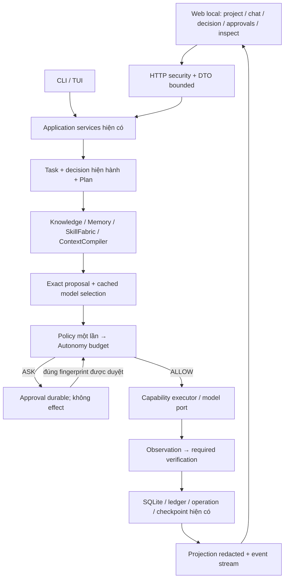

# PAW — điều kiện đóng gói sản phẩm và giao diện web

## Rà soát ngày 2026-10-05

Cập nhật sửa lỗi: F01 intake/lưu stream và F02 transaction cùng process đã được
sửa trên working tree, có regression trong [bản đồ triển khai](IMPLEMENTATION_MAP.md).
Các tái hiện FAIL bên dưới mô tả baseline ban đầu, không phải code đã sửa.
Release vẫn `PARTIAL`. Cập nhật 2026-10-07: B-18 readiness/recovery bounded và
CLI hai approval đạt acceptance working tree (D3: 2262 passed, 3 skipped).
B-19 discovery/payload và lifecycle/bảo mật web còn thiếu; chưa certify clean
release hoặc verification engineering tổng quát.
F06 đã bỏ fallback provider ngầm và chặn executor khi dispatch/provider lỗi;
map ghi proof mới và giới hạn usage/discovery/payload. Inventory B-15 bên dưới
pin entry source/test target, không certify toàn sản phẩm.

Baseline: `9fb893e`, có thay đổi người dùng ở `src/paw/knowledge/index.py`;
giữ nguyên thay đổi đó. Kết quả phát hành sản phẩm: `PARTIAL`. Tại baseline
ban đầu, hai lỗi tái hiện khiến gate streaming/transaction là `FAIL`; sửa lỗi
theo phạm vi về sau được ghi ở phần cập nhật trên.
Đây là bản đồng bộ của `../BETA_LIMITATIONS.md`; đặc tả web là đích cần
triển khai, chưa phải API hay giao diện đã có. Chưa kiểm chứng toàn runtime,
chất lượng cloud thực tế hoặc toàn bộ bảo mật trên revision này.

## Sản phẩm cần giao

Một workstation engineering chạy local, một người dùng: chọn project đã cấu
hình, analyze/ideate/change/review, xem nghiên cứu và quyết định, phê duyệt,
chạy qua PAW, kiểm chứng thay đổi và giữ lịch sử theo phạm vi project.
CLI và web dùng cùng application services và runtime. Web chạy foreground,
bind loopback, không cần daemon/hosting/multi-user/provider mới. Training
là thử nghiệm, không phải điều kiện phát hành.

“Có tất cả tính năng hiện có” nghĩa là bao phủ các luồng CLI được hỗ trợ và
các view/action có giới hạn trên năng lực thư viện. Không biến mọi helper
Python thành endpoint. Tính năng experimental phải hiện nhãn; nút chưa đủ
điều kiện phải giải thích prerequisite. Đo độ đầy đủ bằng ma trận parity.

## Quyết định nghiên cứu trước triển khai

Độ sâu `DEEP`. Vấn đề: CLI sử dụng được và nhiều test riêng lẻ chưa chứng minh
một sản phẩm engineering tích hợp, an toàn, nâng cấp được. HTTP thêm request
đồng thời, retry, lifecycle và tấn công từ browser. Ràng buộc: giữ một
Task/runtime/Policy/SkillFabric/schema owner; không gọi cloud/tốn tiền,
đọc dữ liệu riêng, thêm provider/hosting/training trong rà soát này.
Budget: tài liệu canonical, source các biên chính, proof DB tạm, test nhỏ,
collection và hướng dẫn web chính thức; dừng khi có blocker và work packet
có thể bác bỏ bằng test. Kiểm chứng toàn repo thuộc gate sau.

| Phương án | Ưu điểm | Nhược / bằng chứng ngược |
|---|---|---|
| A. Chỉ sửa CLI, hoãn web | Ít thay đổi, ít attack surface | Chưa đáp ứng giao diện và khả năng quan sát người dùng cần. |
| B. HTTP local + static UI trong wheel, dùng lại service — chọn | Một process/wheel/runtime, tái dùng async Python, chia nhỏ parity | Phải sửa storage đồng thời, lifecycle và bảo mật HTTP; UI không bù được suy luận còn thiếu. |
| C. Frontend/server riêng, hosted workers | Linh hoạt triển khai và cộng tác | Thêm lock/build/deployment/worker/tenancy ngoài phạm vi. |

Readiness: `READY` cho tài liệu và proof giới hạn; code web là
`SPIKE_REQUIRED` đến khi B-15..B-19 đạt. Mỗi packet phải tái xác lập `READY`
trên revision của nó. Stack đề xuất để spike: extra `web` gồm
Starlette/Uvicorn, HTML/CSS/JavaScript cùng origin, stream qua fetch.
Chưa sửa lock/pin dependency. Spike phải chứng minh Python 3.12, asset trong
wheel, accessibility và test transport. Chỉ xét JS framework/build riêng
khi độ phức tạp UI thực sự cần; không suy ra triển khai Sites.

## Các vấn đề và cách giải quyết

P0 chặn web có execution; P1 chặn sản phẩm dùng được; P2 là bảo trì/thử nghiệm.
`OBSERVED` là thấy trong source, không khẳng định mọi đường chạy đều bị lỗi.

| ID | Bằng chứng / vấn đề | Owner và giải pháp | Nghiệm thu có thể kiểm chứng |
|---|---|---|---|
| F01/P0 | `send_streaming` thiếu guard cancelled/pending approval của `send`. Proof DB tạm: send sau cancel=`cancelled`, stream=`completed`. | `application/chat.py`: một intake/runtime path, stream chỉ chuyển event. | Cancel/pending không tạo Task mới, không provider/executor call, không mất approval. |
| F02/P0 | `Database.transaction` dùng connection và `_transaction_depth` chung. B trả thành công, A rollback làm mất row B. | `storage.py`: serialization/connection strategy theo task, gồm write ngoài transaction; lock mỗi session chưa đủ. | B không bị A rollback; không cross-task nesting; cancel rollback/nhả ownership; reopen vẫn giữ dữ liệu đã acknowledge. |
| F03/P0 | Runtime mặc định `readiness='READY'`, revision/constraint rỗng; ChatService không nạp decision/Plan durable. | Runtime/Planner/decision persistence hiện có: mutation bắt buộc FINAL READY đúng Task/revision/fingerprint. | Missing/default/mismatch/stale và cả năm readiness không được viết; proof restart. |
| F04/P0 — **ĐÓNG 2026-10-20** | `ChatService.open()` gọi `initialize_all()` trước task gating, và `ModelRouter.route()` initialize + discover provider trong lúc chọn model, nên mở session hoặc chọn model có thể thực hiện provider I/O mà không có operation nào được authorise. | `ModelRouter.route()` chỉ dùng cache ("selects only from admitted cached manifests", theo AGENTS.md); `discover_providers()` là thao tác tường minh; `PawRuntime._admit_provider_discovery()` chỉ thực hiện sau khi Policy cho phép `Capability.NETWORK_HTTP`; `ChatService.open()` không còn initialize provider. | Đóng bằng `tests/test_b19_f04_discovery_contract.py` (6), có chứng minh fail-positive cho cả hai chỗ I/O ẩn. Khi bị từ chối, cache giữ nguyên và run tiếp tục trên đó. |
| F05/P0 — **ĐÓNG 2026-10-20** | Manifest được kiểm tra riêng, provider nhận `metadata.messages`; chưa bind actual payload hoặc fail closed khi manifest thiếu ở các nhánh này. Lệnh gọi remote không có manifest bỏ qua gate, và tên provider bị dùng làm kind disclosure nên mọi lệnh gọi remote bị từ chối với `unknown_provider_kind` — bảng class chưa bao giờ thực sự quyết định điều gì. | `paw.core.privacy.bind_remote_payload` là ràng buộc canonical: từ chối `manifest_missing`, `foreign_manifest`, lý do từ chối theo từng candidate, `payload_not_approved` và `payload_oversized`, đồng thời ghi digest của payload và manifest. `provider_kind_for()` sở hữu mapping tên→kind theo E1-03. | Đóng bằng `tests/test_b19_f05_payload_binding_contract.py` (13) và `tests/test_b19_f05_provider_kind_contract.py` (16), có chứng minh fail-positive. Thiếu/foreign/stale/substitution/oversize đều ra zero remote call. Secret chưa từng đi vào manifest thì chưa được bao phủ — đó là việc của chat layer và vẫn mở. |
| F06/P1 | Selected provider không đăng ký bị thay bằng stand-in; model exception có thể bị nuốt rồi executor vẫn chạy. | ModelExecutor/Router/runtime: typed failure; stand-in chỉ diagnostic. | Required-model failure/no-route không thành completed engineering qua mock; tool-only local vẫn chạy. |
| F07/P1 | Chat một iteration, `done=True`, mock hội thoại, chỉ local/auto/ollama; library cloud/E2/E3 chưa đồng nghĩa daily workflow tích hợp. | Application service: nối reconnaissance/decision/Plan/runtime/verification, profile là config, compose adapter hiện có. | Foreign repo analyze/idea/review có citation thật; change có READY/approval/diff/check; cloud cấu hình và gate rõ. |
| F08/P1 | Review/approve skill nhận state/text, không bắt buộc replay/version hash; index theo name, lịch sử version cần proof. | SkillFabric là owner, governance helper: replay + exact content/version approval durable. | Missing/failed/negative replay không ACTIVE; sửa body vô hiệu approval; version cũ và rollback sống qua reopen. |
| F09/P1 | README/roadmap/checklist mâu thuẫn; E4 complete nhưng E4-15..20 mở; BETA dựa demo/stand-in. | Canonical docs/inventory: tách lịch sử, item và gate, dẫn lệnh/revision. | Source/parity/docs EN/VI khớp; checkbox không tự certify track; check từ tracked checkout. |
| F10/P1 | Recall foreign corpus thiếu; record mới nhất ghi min recall 0,25, cloud reference bất ổn. | KnowledgeIndex/ContextCompiler/runner hiện có: giữ sửa của user; held-out cases, không tune oracle. | Đạt threshold hoặc yêu cầu bằng chứng thêm; report embedding/negative/corpus/per-case failure. |
| F11/P1 | Chưa thấy web adapter/HTTP guard, release CI, backup/restore trong tracked paths đã rà. Wheel smoke chưa là release nâng cấp được. | Packaging/CLI/storage/application: assets, clean install, backup/upgrade recovery, manifest/CI. | Installed wheel ngoài repo bao phủ parity; upgrade giữ data, restore được; default test không tốn tiền. |
| F12/P2 | Runtime 2670, skills 1397, router 1413, storage 988, chat 950 dòng; E4 evaluation/canary còn mở. | Tách helper thuần có ownership sau proof; không rewrite, E4 read-only experimental. | Một `_execute_unit`, không manager trùng, artifact chưa nghiệm thu không route production. |

## Ma trận tính năng và màn hình

Mỗi tính năng mang nhãn supported CLI / library-needs integration /
experimental; backend quyết định control có được bật không.

| Màn hình | Năng lực hiện có | Web cần hiển thị / phần còn thiếu |
|---|---|---|
| Setup/diagnostics | init/doctor/config/profiles, settings | Version/schema/DB/provider state, secret redacted, không trả credential. |
| Projects/context | workspace, scanner, KnowledgeIndex, Compiler | Root do server cấu hình, index/freshness/source/symbol/test/change; ingestion bounded, không client absolute path. |
| Sessions/chat | ChatService/StateStore, CLI/TUI | List/create/reopen/history/send/stream/status/approve/resume/cancel; thêm projection listing/cursor. |
| Research/decision | E2 contracts/storage, runtime inspect | Depth/evidence/options/contrary/budget/FINAL/readiness/freshness/clarification; missing phải hiện missing. |
| Plan/graph | Planner/Scheduler/run_graph; `/plan` là last action | Tách exact operation preview với Plan/DAG thật; dependency/failure/restart; cần application bridge. |
| Change/approvals | ApprovalStore/filesystem executor | Diff/path/capability/privacy/cost; exact fingerprint/version; reject/cancel, không blanket approval. |
| Verification/artifacts | Outcome/check contracts/artifact projection | Observation khác engineering check khác release evaluation; xem text/download bounded; không file endpoint tùy ý/shell. |
| Inspect/timeline | why/ledger/checkpoint/policy/skills/beta inspect | Durable events, stop reason, included/excluded/hash/privacy/token; paginate/redact. |
| Models/budgets | Router/Registry/Executor | Cached roles/eligibility/escalation/fallback; usage thật khác estimate; refresh gated; cloud library chưa là mode chat. |
| Memory/knowledge | Store/Retriever/source/evidence/citation | Scope/provenance/correction/retention; mutation qua audited service command. |
| Skills | SkillFabric/governance/replay | Version/candidate/review/replay/approve/reject/deprecate/rollback/metrics; tắt write đến F08 đạt. |
| Evaluation/adaptation | bench/dataset/evaluation | Read-only report và hash/experimental badge; không training trigger/raw capture/cloud spend ngầm. |

## Sơ đồ và quy tắc thực thi

### Inventory source/proof B-15 — `9fb893e` + working tree hiện tại

S = CLI hỗ trợ; L = library cần application bridge; E = experimental. Đây là
entry point và test target, không certify toàn feature. Row hỗn hợp không có
nghĩa write đã web-ready. Lệnh/kết quả ở Implementation Map; inventory E0 cũ
là lịch sử, không parity hiện tại. Source dưới đây tính từ `src/paw/`; test
filename đều thuộc `tests/`.

| Nhóm / tier | Entry/source thực tế | Proof target / bridge thiếu |
|---|---|---|
| Setup/S | cli doctor/init/config/profiles; core/config.py | test_phase0.py, test_beta_profiles.py; web config command redacted chưa có. |
| Project/context/L | core/repo_scanner.py, KnowledgeIndex, ContextCompiler | test_e1_10_symbol_ownership_contract.py, test_e1_11_test_associations_contract.py, test_e1_12_recent_changes_contract.py; retrieval repo ngoài và bounded intake chưa qualified. |
| Session/chat/S | application/chat.py:ChatService; CLI/TUI | test_chat_cli_demo.py, test_productization_intake.py; HTTP list/cursor/reconnect thiếu. |
| Research/decision/L | reasoning_contracts, storage.record_decision, runtime.inspect | test_e2_28_decision_persistence.py, test_e2_43_inspect_output.py; CRUD/string thủ công không chứng minh FINAL durable B-18. |
| Plan/graph/L | Planner, TaskScheduler, runtime.run_graph | test_planning_contract.py, test_phase19_taskgraph_validation.py, test_runtime_unit_pipeline.py; /plan chỉ last-action projection, không DAG service/editor. |
| Change/approval/S gated | ApprovalStore, filesystem executor, chat approve/resume/cancel | test_chat_cli_demo.py, test_local_filesystem_executor.py, test_external_effect_reconciliation.py; thiếu readiness/browser retry/CSRF. |
| Verification/artifact/S+L | artifacts_projection, bench/verification.py, runtime outcome | test_e0_39_verification_types.py, test_chat_cli_demo.py; type/artifact display không phải integrated engineering verification B-20. |
| Inspect/timeline/S | chat_inspection.py, cli beta_inspect | test_chat_cli_demo.py, test_beta_demos.py; HTTP DTO/redaction/pagination thiếu. |
| Model/budget/S+L | ModelRouter, ModelExecutor, ExecutionProfile | test_phase19_model_executor.py, test_model_dispatch_fail_closed.py, test_phase10_execution_profile.py; discovery/payload và failed usage còn thiếu. |
| Memory/knowledge/S+L | MemoryStore/Retriever, knowledge records, beta inspect memory | test_phase12_memory_retrieval.py, test_phase13_context_builder.py; correction/retention và scoped HTTP bridge thiếu. |
| Skill/S+L | SkillFabric, skill_governance helpers, inspect | test_e3_transitions.py, test_e3_replay.py, test_e3_migration_proof.py; exact replay/hash/version còn F08, chưa bật web writes. |
| Evaluation/adaptation/E | bench/runner.py, bench/e1_production.py, core/dataset.py | test_e0_16_runner.py, test_e4_dataset_governance.py, test_e4_integration_pack.py; fixture/contract không chứng minh artifact training hay cloud live; không web training command. |

B-15 release evidence vẫn `PARTIAL` đến khi scenario supported có installed-wheel
parity proof. Không dùng danh sách test thay cho kết quả chạy của revision hiện tại.

Web shell ba vùng: navigation trái gồm Projects/Sessions/Decisions-Plans/
Approvals/Memory-Knowledge/Skills/Models/Diagnostics; giữa là chat hoặc view
đang chọn; inspector phải là evidence/context/routing/policy/checks/artifacts.
Luôn thấy project/revision/profile, model thật hay stand-in và task stop state.
Đổi project không tự chuyển session. Approval là màn hình exact change riêng,
không generic chat confirm. Detail mở dần để chat dễ đọc nhưng vẫn audit được.
Nghiệm thu UX: tiếng Việt UTF-8, keyboard/focus/contrast, narrow responsive,
loading/empty/error/unavailable; reload/reconnect không mất durable state.
Thinking stream không authority hoặc feature bắt buộc; evidence/decision
summary/uncertainty đủ, không cần phơi bày suy luận ẩn.

- Analyze/ideate/review: read-only; source trước; inference vẫn gate
  Policy/disclosure/budget; trả citation và uncertainty.
- Change: FINAL READY đúng Task/revision/constraints → Plan → exact proposal
  → Policy/Autonomy; ASK chờ; chỉ thành công engineering khi required checks đạt.
- Missing evidence/no cloud route: research bounded, clarify hoặc typed stop;
  UI không thay bằng stand-in hoặc tự READY.
- Double click/retry: durable request/operation key, một effect/consumed
  approval, kể cả refresh browser.
- Disconnect không đồng nghĩa cancel/complete; reconnect đọc durable state.
  Cancel rõ ràng ở safe boundary; không bỏ async task không quản lý.
- Crash sau effect: reconcile prepared intent; ambiguous thì block, không rerun.
- Required DAG node fail: block dependents và không báo graph success.

## Ranh giới local web — đã quyết định và có nền tảng (2026-10-21)

Packet B-23..B-26 được giao dưới dạng một quyết định và một nền tảng an toàn,
không phải HTTP handler. `docs/adr/0001-local-web-adapter.md` là quyết định;
`src/paw/web/security.py` và `src/paw/web/requests.py` là ranh giới và ngữ nghĩa
request. Chúng transport-agnostic, nên các control chứng minh được mà không cần
dựng server, và HTTP framework vẫn là một quyết định còn mở.

Ranh giới nay enforce điều gì, và chứng minh ở đâu:

| Control | Ở đâu | Bằng chứng |
|---|---|---|
| chỉ bind loopback | `LocalWebGuard.check_bind` | `test_local_web_security_contract.py` |
| allowlist `Host` chính xác | `check_host` | same |
| `Origin` chính xác, không wildcard CORS | `check_origin` | same |
| CSRF token cục bộ cho mutation | `check_csrf` | same |
| giới hạn body / history / stream | `check_body_size`, `check_history`, `check_stream_buffer` | same |
| không mang credential trong query string | `check_query` | same |
| write admission toàn process | `write_lock` | same |
| request key tái dùng durable operation identity | `RequestKeyPolicy.operation_identity` | `test_local_web_request_contract.py` |
| disconnect được kiểm tra, không phải hoàn thành hay huỷ | `ReconnectPolicy` | same |
| core không import HTTP type và không import `paw.web` | layering | same |

HTTP framework, static asset đóng gói và CSP, cùng hình dạng bề mặt API vẫn
còn mở — chúng là packet tiếp theo, và hợp đồng bên dưới vẫn chi phối chúng.

## HTTP contract để spike — chưa có trong source

Transport đề xuất ở `src/paw/web/`; service/projection ở application;
asset ở `src/paw/web/static/`. Core không import HTTP/frontend type.
Không shell-out CLI, browser SQL, provider gọi riêng hoặc generic tool route.

Target `/api/v1`:

- GET capabilities/health: support level, revision/schema/redacted diagnostics;
  cached, không hidden I/O.
- GET/POST sessions, GET session messages với cursor/limit; check workspace
  binding/unknown IDs.
- POST session messages: message/profile/request key validated; trả durable
  Task ID, không auto-retry mutation POST.
- GET task/state/events cursor: durable state là authority, token là ephemeral.
- GET task inspect kind: allowlist decision/plan/context/routing/policy/ledger/
  checkpoint/verification/artifacts, không method name tùy ý.
- POST approval approve/reject, task resume/cancel: fingerprint/version/key,
  scope/conflict checks; service thiếu phải làm/test trước khi expose.
- Skill/memory/config typed route sau packet của owner; read-only trước;
  không training route.

Dedup dùng durable operation identity hiện có khi phù hợp; nếu intake cần
record mới, ADR/schema chỉ ở storage, Task creation atomic và proof crash/retry.
Map in-memory không đủ restart safety. Error có code/message an toàn và
correlation/task ID, không stack trace/credential.

Bind mặc định `127.0.0.1`, từ chối non-loopback trong release này. Host và
exact Origin allowlist; bootstrap/auth local + CSRF cho mutation, không
wildcard CORS. Không token trên URL/log/localStorage. Same-origin assets,
CSP, escape text/Markdown không raw HTML, giới hạn body/history/stream;
không fetch URL/path tùy ý. Startup/shutdown sở hữu provider/DB lifecycle.
Trước F02 không concurrent write; session lock chưa đủ. CLI/web chung DB
cần process lock hoặc SQLite concurrency model được chứng minh. Một ASGI
process, không distributed worker.

Tham khảo chính thức ngày 2026-10-05:
[Starlette middleware](https://www.starlette.io/middleware/) về Host/CORS;
[OWASP CSRF](https://cheatsheetseries.owasp.org/cheatsheets/Cross-Site_Request_Forgery_Prevention_Cheat_Sheet.html)
về token/exact origin. Chúng hỗ trợ thiết kế, không chứng nhận PAW an toàn.

## Chia việc cho agent và nghiệm thu

B-15..B-36 ở checklist, dependency ở roadmap. Agent đọc canonical docs,
ghi baseline/invariant/scope/READY, nhận một packet, trả exact command
evidence; không tự mở E4 hoặc reinterpret gate lịch sử.
Phân công gợi ý: storage F02; runtime/security F03..F06; application F01/F07;
UI/HTTP; release/docs F09/F11. Đây là handoff, chưa dispatch agent tự động.
Không cùng sửa runtime/storage/skills/chat; chốt DTO/service trước UI song song.
Giữ sửa index của user; merge từng thay đổi nhỏ có proof.

Release: zero P0; parity supported có proof installed wheel; một engineering
trace repo ngoài thật gồm decision/change gated/required verification/inspect/
restart; phân biệt stand-in; browser rejection/retry/crash controls; hướng dẫn
install/upgrade/backup/restore/shutdown; D3 trên clean revision. Cloud chất
lượng đánh giá riêng có opt-in/consent/budget, không default suite. Alpha
local có thể thiếu cloud nhưng phải ghi phạm vi rõ.

Ước lượng, giả định một engineer kinh nghiệm 6 giờ tập trung/ngày, giữ biên
hiện có: 3–6 ngày baseline/security/storage; 4–8 ngày application;
3–5 ngày HTTP/web shell; 5–9 ngày parity; 2–4 ngày đóng gói/release.
Tổng 17–32 ngày tập trung, khoảng 4–8 tuần gồm review; chưa là velocity đo
thực tế, re-estimate sau B-15..B-19. D0/D1/D2 theo packet, D3 chỉ khi core
boundary trigger và candidate cuối.

## Giới hạn của bản BETA lịch sử tháng 9

### Bằng chứng command trên working tree hiện tại

Baseline `9fb893e` + sửa index user + documentary delta:
`uv sync --locked --extra dev`: 38 resolved/37 checked;
named chat/atomicity/unit pipeline: 13 passed/24,65s;
`pytest --collect-only -q`: 2131 collected/11,14s (không phải test success);
`pytest -q tests/test_project_lock.py tests/test_productization_document_contract.py`:
7 passed/3,04s; Ruff test mới và `git diff --check` đạt.
Không full suite/build/live provider. Hai diagnostic negatives vẫn FAIL cần
sửa. Test mới chỉ kiểm tra tài liệu đồng bộ, không runtime correctness.
Chưa triển khai production repair hay web server trong thay đổi này.

Bản EN giữ record 2026-09-13: các demo analyze/ideate/change/review đã dùng
runtime chung, nhưng inference là echo stand-in, step_fn inject evidence,
capability demo advisory; không chứng minh full skill/provider pipeline.
Từ 2026-10-07 change demo dùng ChatService với review decision rồi approval
operation riêng; approval đơn lẻ không tạo readiness. Read-back là OBSERVED,
không engineering verification. Demo recovery control chỉ phủ denied/duplicate
create refusal, không phải same-Task crash recovery. Test runtime riêng đối soát
intent prepared local sau crash/reopen; không chứng minh arbitrary external
atomicity. Privacy local-only được cấu hình, không đo remote payload thực.
Answer evidence/uncertainty/next_action là demo-provided, không full durable
E2 decision. Demo DB riêng trong `/tmp`, không workspace persistent chung.
Wheel được build/install tạm, không artifact phát hành/nâng cấp. Không tenant
isolation/authentication. Những giới hạn này không được biến thành lời hứa
product release hiện tại; bảng F01..F12 và gate mới là hướng đóng gói.
