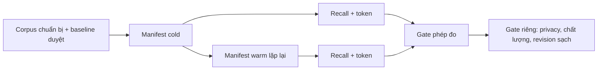

# Bản đồ triển khai và audit ổn định PAW

## Chụp working tree — 2026-10-20

Base revision `9fb893e2017eceb01d80be4de7ee7a3744eb8ce5`. Lệnh chụp:
`git status --short --untracked-files=all`, `git diff --stat HEAD`,
`git ls-files --others --exclude-standard`, `git rev-parse HEAD`.

Trạng thái chụp: **68 path** — 55 sửa, 13 untracked; `+3672 / -697` trên diff
đã track. Đây là *toàn bộ* working tree chưa commit tại đầu đợt sửa
2026-10-20, trải qua nhiều phiên trước.

Phân loại — mỗi path gán đúng một track owner:

| Track | Path đã chụp | Số |
|---|---:|---:|
| B-18 decision evidence | `src/paw/core/{storage,reasoning_contracts,planner,approval,policy}.py` + 5 file test | 10 |
| B-18 runtime admission | `src/paw/core/{runtime,runtime_persistence,checkpoint,repo_scanner}.py`, `src/paw/knowledge/checksum.py` + 16 file test | 21 |
| B-19/F06 fail-closed dispatch | `src/paw/core/model_executor.py` + 3 file test | 4 |
| B-18 CLI two-approval | `src/paw/application/chat.py`, `demos/demo_change.py` + 3 file test | 5 |
| Evidence repair (ledger/benchmark) | `src/paw/core/{models,ledger}.py`, `benchmarks/runtime/run_e2e.py` + 1 file test | 4 |
| Docs status sync | `README.md`, 10 `docs/*.md`, 10 `docs/vi/*.md` + 2 file test | 22 |
| Phase D recovery test repair | `tests/test_phase_d_recovery.py` | 1 |
| Preserved user change | `src/paw/knowledge/index.py` | 1 |
| Unrelated | `None identified` | 0 |

Dòng `Unrelated` là một hợp đồng: mọi diff hunk đã được xem và gán. Dòng
`Preserved user change` là `src/paw/knowledge/index.py` — một thay đổi scoring
retrieval cho file ngắn thưa, giữ nguyên từ working tree của user và commit
riêng để không bao giờ bị quy cho một track của PAW.

## Sửa độ tin cậy bằng chứng — 2026-10-20, STANDARD / READY

Xử lý các lỗi ledger/usage làm cho số liệu chi phí và token không dùng được,
cùng mâu thuẫn trạng thái trong tài liệu khiến agent khác phải tự suy luận lại
trước khi tiếp tục.

### Ghi nhận usage vào ledger (code)

Hai lỗi, đều đã xác nhận bằng đọc source và tái hiện bằng contract test mới:

1. **Sai key.** `RuntimePersistence.commit_operation` serialize `ResourceUsage`
   bằng `model_dump()`, chỉ phát ra các *field* pydantic (`model_calls`,
   `tokens`, ...). `provider_calls` là *method* của `ResourceUsage` nên vắng mặt
   trong payload STEP_EXECUTED. `TaskLedger.get_model_call_count` đọc
   `resources_used["provider_calls"]` và vì vậy **luôn trả 0** cho mọi task do
   runtime ghi, dù đã có bao nhiêu model call thật.
   `assert_model_calls_monotonic` cũng vô nghĩa vì lý do tương tự.

   Sửa: `ResourceUsage.to_ledger_dict()` giờ là cách serialize canonical duy
   nhất cho usage ghi vào ledger (field gốc cộng `provider_calls` /
   `total_tokens` / `total_cost_usd` của receipt). `commit_operation` dùng nó.
   Reader của ledger cũng chịu được `resources_used` bằng `None`.

2. **Đếm trùng event.** `commit_operation` vốn đã ghi một event STEP_EXECUTED,
   ngay trong transaction cùng `OperationRecord`. `_execute_unit` lại ghi
   *thêm* một STEP_EXECUTED cho cùng operation, nên mỗi operation sinh ra hai
   event và một reader đã sửa sẽ đếm mỗi call hai lần.

   Sửa: bỏ lần ghi thứ hai. `commit_operation` là writer STEP_EXECUTED duy nhất
   có thẩm quyền. `StepProposed` vẫn ghi *ước tính*; STEP_EXECUTED ghi thực tế.

**Bằng chứng.** `tests/test_ledger_usage_accounting_contract.py` (6 test).
Chứng minh fail-positive: khôi phục cả hai lỗi làm fail 5/6 (test thứ sáu là
control về quyết định). Regression sweep tập trung: 57 test qua E2-34, Phase 19
runtime hardening/loop, E2-20 resume, external-effect reconciliation, runtime
atomicity và outcome task identity — tất cả pass. Sweep rộng hơn: 287 test qua
E2-3x/E2-4x, ledger, phase-D recovery và E1-2x — tất cả pass. Ruff sạch.

**Còn mở (chưa sửa ở đây).** Usage cuối đường executor vẫn suy ra từ
`estimated_cost`, chưa phải receipt từ provider, nên đo token/chi phí theo
provider vẫn chỉ xấp xỉ. Chưa được kết luận về hiệu quả router hay tiết kiệm
cloud từ các số này.

### Quy kết oracle của benchmark (benchmark)

`benchmarks/runtime/run_e2e.py` đo oracle theo cách không phân biệt được "PAW
đã thực hiện thay đổi" với "PAW đã từ chối và một lần ghi file trực tiếp đã làm
nó":

* oracle **baseline** chạy *sau* các lần PAW ghi, nên "baseline" thực chất là
  trạng thái sau ghi;
* script sau đó `git checkout -- .` và ghi cả hai file **trực tiếp** bằng
  `write_text()`, nên phép đo "after" mô tả lần ghi trực tiếp chứ không phải
  output của PAW;
* chương trình `return 0` vô điều kiện, nên oracle fail cũng không làm
  benchmark fail.

Sửa: oracle baseline đo trên repository nguyên trạng **trước** mọi lần ghi;
oracle "after" đo trên đúng file PAW đã tạo ra (không reset, không ghi trực
tiếp); và exit code nay phản ánh một verdict tường minh. `FAIL` được trả về
khi có bất kỳ file nào PAW chưa ghi được, hoặc khi oracle có failure mới.
`PASS` đòi hỏi PAW thực sự thực hiện thay đổi.

**Chưa đóng.** `paw_write` trong harness đó đề xuất action `FILESYSTEM_WRITE`
mà không có implementation Plan đã lưu, không có ràng buộc project root và
không có decision đã review, nên theo hợp đồng admission hiện tại runtime sẽ
từ chối lần ghi. Benchmark nay báo cáo trung thực là `FAIL` thay vì âm thầm
chứng nhận một lần ghi trực tiếp. Việc nối harness vào một Plan + binding đã
review thật là phần công việc còn lại; cho tới lúc đó benchmark này là *negative
control*, không phải một lần pass.

### Kích thước module và phân tách trách nhiệm (ghi nhận, không phải work item)

Kích thước source hiện tại: `runtime.py` 2743, `model_router.py` 1413,
`skills.py` 1397, `storage.py` 1226, `context_compiler.py` 1186,
`application/chat.py` 1031.

Số dòng tự nó không chứng minh thiết kế sai, nhưng nó chỉ ra coupling nằm ở
đâu: `runtime.py` đang gánh routing, reconnaissance, admission, privacy,
execution, recovery và usage accounting, còn `chat.py` gánh thêm việc dựng
decision/review. Hướng an toàn kế tiếp là tách những trách nhiệm đã có proof,
vẫn giữ một orchestrator duy nhất — **không** tạo thêm lớp "manager" và
**không** viết lại framework. Đặc biệt, fix F04/F05 thuộc về chỗ sở hữu
provider discovery và outbound payload, không phải một abstraction mới.

### B-19/F05: ràng buộc payload gửi đi với manifest đã review — 2026-10-20, STANDARD / READY

**Lỗi.** Đường remote chỉ hỏi một câu — "manifest này có được gửi tới provider
này không?" — và `gate_remote_disclosure` trả lời trên `manifest.included`. Nhưng
byte thực sự gửi đi là thứ khác: `action.metadata["messages"]`, một kênh độc
lập mà manifest không mô tả. Ba lỗ hổng:

* lệnh gọi remote **không có manifest** bỏ qua gate hoàn toàn
  (`if manifest is not None:`), nên không có gì authorise nó;
* manifest thuộc **task khác** vẫn được chấp nhận;
* nội dung mà quyết định disclosure **từ chối** vẫn có thể tới provider qua
  danh sách message — gate chứng minh một thuộc tính của *manifest*, không phải
  của *payload*.

**Sửa.** `paw.core.privacy.bind_remote_payload` là ràng buộc canonical mới. Nó
từ chối theo thứ tự: `manifest_missing` (fail closed — lệnh gọi remote không có
manifest thì không có gì authorise nó), `foreign_manifest`, các lý do từ chối
theo từng candidate tái dùng từ `gate_remote_disclosure`, `payload_not_approved`
(payload mang nội dung mà disclosure đã từ chối, hoặc nội dung từ một bản ghi
SECRET/WORKSPACE mà compiler đã thấy nhưng không đưa vào), và
`payload_oversized` (payload vượt ngân sách của chính manifest). Kết quả mang
digest của payload và của manifest để bản ghi audit nêu đúng byte và đúng bằng
chứng bao phủ chúng. Cả hai đường remote trong `_execute_action` đều gọi nó.

**Một lỗi thứ hai phát hiện khi làm việc này.** Runtime dùng *tên* provider làm
*kind* disclosure (`PROVIDER_LOCAL if name == "ollama" else name`). Với mọi
provider cloud thật, giá trị đó nằm ngoài `PROVIDER_KINDS`, nên mọi lệnh gọi
remote đều bị từ chối với `unknown_provider_kind` và **bảng class chưa bao giờ
thực sự quyết định điều gì**. `provider_kind_for()` giờ sở hữu mapping theo
E1-03: provider on-box (`local`, `offline`, `vllm`, `ollama`) là `local`, cloud
được charter cho phép là `cloud_approved` (tập được cho phép **rỗng mặc định**,
theo hợp đồng E1-03 hoãn cloud baseline), còn lại là `cloud_unapproved`.
`ModelManifest.local` nay đọc cùng một tập canonical nên hai bên không thể
trôi lệch nhau.

**Bằng chứng.** `tests/test_b19_f05_payload_binding_contract.py` (13 test) và
`tests/test_b19_f05_provider_kind_contract.py` (16 test).

*Chứng minh fail-positive.* Khôi phục gate cũ `if manifest is not None` làm
`test_remote_call_without_manifest_makes_zero_provider_calls` fail với provider
remote thực sự bị gọi (`{'model': 'remote-llama', 'messages': [...]}`). Tắt
binding check làm fail `test_payload_carrying_refused_content_refuses` và
`test_excluded_secret_record_cannot_ride_the_payload`. Tắt nhánh local của
mapper làm fail 6 test provider-kind.

*Tương tác.* `tests/test_model_dispatch_fail_closed.py` trước đây tới được
provider remote mà không có manifest. Nay điều đó bị từ chối trước khi tới
provider — đúng như vậy — nên test được cấp một manifest gắn với task của nó.
Test đó về *dispatch* failure, không phải disclosure; gate nằm upstream. 32 test
pass.

**Còn mở.** Một secret chưa từng đi vào manifest (ví dụ được gõ vào một lượt
chat) không bị binding phát hiện, vì binding chỉ thấy được những gì compiler
đưa lên. Phân loại raw user text là việc của chat layer, không phải của
manifest.

### B-19/F04: provider discovery là thao tác tường minh, do Policy cho phép — 2026-10-20, STANDARD / READY

**Lỗi.** Có hai chỗ provider-I/O ẩn:

* `ChatService.open()` gọi `initialize_all()`, nên *mở một phiên chat* đã
  chạm provider mà không có operation nào được authorise;
* `ModelRouter.route()` gọi `ensure_providers_ready()` rồi `discover_models()`,
  nên *chọn một model* đã chạm provider mà không có operation nào được
  authorise.

Hợp đồng AGENTS.md vốn đã nói đúng hình dạng mong muốn: *"Model Router selects
only from admitted cached manifests"*. Code chưa khớp.

**Sửa.**

* `ModelRouter.route()` nay **chỉ dùng cache**: đăng ký các model local
  stand-in và chọn từ các manifest đã được admit. Nó không còn initialize hay
  discover provider.
* `ModelRouter.discover_providers()` là thao tác discover **tường minh**. Nó
  đăng ký model local stand-in trước (để cache luôn có fallback, bất kể thứ tự
  admit), initialize provider và admit model của chúng.
* `_available_provider_names()` không còn dò provider. Provider chưa được
  initialize báo `available is None`; manifest cache của nó vẫn dùng được, vì
  việc admit đã là một quyết định. Provider đã initialize và báo
  `available == False` thì bị loại.
* `PawRuntime._admit_provider_discovery()` chỉ discover sau khi Policy cho
  phép `Capability.NETWORK_HTTP` qua cùng single-authority gate. Khi bị từ
  chối, cache giữ nguyên và run tiếp tục trên manifest đã cache.
* `ChatService.open()` không còn initialize provider.
  `ChatService.__init__` nhận thêm registry `providers` tuỳ chọn để caller (hay
  test) có thể cấp provider riêng.

**Bằng chứng.** `tests/test_b19_f04_discovery_contract.py` (6 test).

*Chứng minh fail-positive.* Khôi phục discover ẩn trong `route()` và
initialize ẩn trong `ChatService.open()` làm fail
`test_routing_performs_no_provider_io` và
`test_opening_a_chat_session_does_no_provider_io`.

*Tương tác.* `tests/test_phase15_model_router_v2.py` trước đây dựa vào việc
`route()` tự discover; nay nó gọi `discover_providers()` tường minh trước, và
một test mới ghim rằng chỉ routing thì không discover và không initialize. 12
test pass.

### Engineering workflow, chứng minh end-to-end — 2026-10-20, STANDARD / READY

**Khoảng trống.** Runtime có đủ mọi mảnh của chuỗi nhưng không có chuỗi. Context
project đã compile chỉ bị tóm tắt thành fragment count và token estimate, model
chưa bao giờ thấy nguồn đã truy xuất. `model_result` của proposal là `{}`.
`_build_messages()` được định nghĩa rồi không bao giờ được gọi. Không có
artifact cho một verification engineering, và không có quy tắc nào nói rằng một
thay đổi chưa có verification thì chưa xong.

**Đường suy luận (code).** `PawRuntime._model_payload()` dựng payload gửi đi từ
**manifest** — bản đã review, đã ngân sách, đã kiểm disclosure của compiled
context — thay vì từ lịch sử hội thoại hay chỉ goal. Included candidate của
manifest chính là nội dung project, và đó cũng chính là bằng chứng mà payload
binding của B-19/F05 kiểm tra, nên thứ rời khỏi máy là thứ bằng chứng bao
phủ, và model suy luận trên đúng thứ đã truy xuất. Caller vẫn có thể truyền
message hội thoại (chat REPL có truyền); các message đó được giữ, và context
đã review được thêm thành một block riêng.

**Declared verification (code).** `VerificationRecord` (`paw/core/models.py`) là
artifact bất biến nêu tên đã kiểm gì, kiểm với mục tiêu nào, bằng phương pháp
nào, kết quả và bằng chứng ra sao. Nó được ghi dưới event ledger riêng,
`VERIFICATION_RECORDED` — khác `STEP_EXECUTED` (thành công của executor), và
khác một phán quyết gate. `paw/application/workflow.py` sở hữu verification
port: PAW không chạy shell (charter không cấp quyền shell execution), nên việc
kiểm do port mà application cấp thực hiện, còn PAW ràng buộc và ghi lại kết quả.

**Workflow (application).** `EngineeringWorkflow` ghép các primitive sẵn có — Task,
Decision, Plan, policy gate, shared executable unit, executor, checkpoint,
ledger — thành research -> choose -> change -> declared verification. Nó không
thêm quyền điều phối nào: mỗi phase là một runtime task bình thường, có gate,
ledger trail và checkpoint riêng. Quy tắc mà nó tồn tại để bảo vệ là **một thay
đổi chưa có declared verification pass thì chưa phải thay đổi đã hoàn thành**.

**Bằng chứng.**

* `tests/test_engineering_workflow_contract.py` (6 test) — cả chuỗi trên một
  project tạm thật, với ingest knowledge thật, vòng đời decision thật, Plan đã
  review thật, shared unit thật và filesystem executor thật. Nó chứng minh:
  phase research cite đúng nguồn đã đọc; phase choose không thể bỏ qua (Planner
  từ chối implementation Plan khi chưa có decision FINAL READY đã review); approval
  bị từ chối thì không thay đổi gì; verification **fail** được ghi lại và thay
  đổi **không** coi là hoàn thành; **restart** sau failure đó không lặp lại thay
  đổi đã xong, và verification sau đó pass thì hoàn thành chuỗi; và record bất
  biến, gắn với operation nó verify.
* `tests/test_inference_context_wiring_contract.py` (2 test) — nội dung project đã
  compile thực sự tới payload của provider, và context trong payload chính là
  included candidate của manifest.
* `demos/demo_engineering_workflow.py` — chuỗi như một artifact chạy được: một
  failure, một restart, và một verification hoàn thành.

*Chứng minh fail-positive.* Khôi phục payload cũ (không có context manifest) làm
fail cả hai test inference-wiring. Khôi phục "thay đổi xong là hoàn thành" làm
fail `test_a_failing_verification_is_not_a_completed_change`.

**Còn mở.** Workflow chứng minh chuỗi trên một thay đổi *mô phỏng*; nó chưa
chạy với test suite thật của một project, vì PAW không chạy shell. Verification
port là chỗ một CI hay test harness thật cắm vào, và tích hợp đó là phần tiếp
theo.

### Phiên bản personal skill — 2026-10-20, STANDARD / READY

**Các lỗi.** "Học skill cá nhân rồi rollback an toàn" là bất khả thi chứ không
phải chỉ là chưa được test:

* index trong bộ nhớ được key theo **tên**, nên một candidate cùng tên thay thế
  manifest đang có — một phiên bản trước đó không với tới được;
* persistence dùng **tên làm id row** với `INSERT OR REPLACE`, nên lưu phiên
  bản mới xoá mất row cũ;
* `rollback_skill` tìm trong đúng index một-entry-per-name đó, nên không bao giờ
  tìm thấy phiên bản khác: rollback về phiên bản trước là bất khả thi về cấu
  trúc;
* `review_skill` và `approve_skill` chỉ gắn theo **tên**, nên approval có thể
  mang sang nội dung khác;
* cả hai đều không bắt buộc **replay**. Skill là văn bản có thể thực thi; đọc
  nó không phải là chạy nó. Nhánh supersede của `approve_skill` cũng là code
  chết: nó so sánh index entry với chính nó.

**Sửa.**

* `SkillFabric` giữ **lịch sử phiên bản** theo `(tên, phiên bản` bên cạnh
  index của phiên bản hiện tại. Index vẫn resolve phiên bản hiện tại; lịch sử
  giữ mọi phiên bản còn với tới được.
* Id row của persistence nay là cặp `(tên, phiên bản)`, nên phiên bản mới là
  **row mới** và phiên bản cũ còn lại. Thứ tự load được sắp xếp để phiên bản
  cập nhật gần nhất là phiên bản hiện tại.
* `content_hash()` băm body, trigger và capabilities — thứ reviewer đọc và thứ
  executor chạy. Thay đổi bất kỳ cái nào trong số đó làm approval cũ mất hiệu
  lực.
* `review_skill` và `approve_skill` nhận **đúng phiên bản** và **bằng chứng
  replay** (`SkillReplayEvidence`). Replay fail, thiếu hoặc âm tính thì không
  review được và không activate được. Record review và approval mang phiên bản,
  content hash và chi tiết replay.
* `approve_skill` supersede phiên bản ACTIVE trước đó tìm thấy trong **lịch
  sử**, và từ chối khi nội dung đã đổi sau lúc review.
* `rollback_skill` tìm trong lịch sử một phiên bản **trước**, đánh dấu bản hiện
  tại là superseded, và đưa bản đích trở lại làm hiện tại. Rollback về chính
  phiên bản hiện tại bị từ chối: đó không phải rollback.
* `SkillGovernance.promote_to_active` truyền version và replay xuống.

**Bằng chứng.** `tests/test_skill_versioning_contract.py` (10 test). Nó chứng
minh hai phiên bản của một skill là hai row và cả hai còn lại sau reopen; review
không có replay bị từ chối, và review có replay fail cũng bị từ chối; approval
không có replay không activate được skill; nội dung đổi làm approval mất hiệu
lực; approve một phiên bản không approve phiên bản khác; rollback tìm thấy phiên
bản trước, làm nó trở lại hiện tại, và còn lại sau reopen; một phiên bản gần
giống không phải là khớp.

*Chứng minh fail-positive.* Khôi phục name-as-row-id, rollback chỉ tìm trong
index và "review không cần replay" làm fail 6/10.

**Còn mở.** Replay do caller cung cấp, không phải PAW: PAW không chạy shell, nên
bằng chứng rằng skill thực sự chạy đến từ application. Các caller của
governance module phải được cập nhật để cung cấp nó.

### Usage receipt từ provider — 2026-10-20, STANDARD / READY

**Lỗi.** Runtime ghi `action.estimated_cost` làm usage của step. Đó là cái một
lệnh gọi được *dự kiến* tốn bao nhiêu, và nó được gọi là usage. Bản đếm của
chính provider chưa từng được xét, nên các con số token và chi phí trong ledger
không dùng được để quyết định tiền đi đâu.

**Sửa.** `UsageReceipt` (`paw/core/models.py`) là một hình dạng duy nhất runtime
đọc, và nó chuẩn hoá các cách provider báo: OpenAI báo `prompt_tokens`/
`completion_tokens`, Ollama báo `prompt_eval_count`/`eval_count`. Adapter Ollama
nay phát hành receipt từ số đếm nó thực sự nhận; adapter OpenAI vốn đã trả
`usage` của provider. Runtime thay estimate bằng receipt khi có, và **giữ estimate
khi không có** — thiếu receipt không phải là số 0.

**Bằng chứng.** `tests/test_usage_receipt_contract.py` (7 test): các dialect
receipt được chuẩn hoá; usage hỏng hoặc vắng mặt bị bỏ qua chứ không bị đếm
thành 0; receipt quan sát được thay estimate; estimate còn lại khi provider không
phát hành gì; và receipt tới được ledger, nơi số model call đếm được và số token
ghi lại khớp nhau.

*Chứng minh fail-positive.* Bỏ qua receipt làm fail 2/7.

**Một phát hiện, ghi nhận chứ không sửa.** `ResourceUsage.total_cost()` quy
model call là 1.0, tool call là 0.5 và nghìn token là 1.0, trong khi trần chi phí
theo role là 0.01–0.20 USD. Hai bên khác đơn vị, nên một action *khai báo*
estimate có model call bị chặn bởi trần role trước cả khi gọi. Trọng số được
ghim bởi `tests/test_e2_33_step_usage_receipt.py`, nên ở đây không sửa ngầm; các
đơn vị cần một quyết định (đơn vị tương đối hay USD) trước khi hoà giải được.

### Harness runtime e2e là một bằng chứng thật — 2026-10-20, STANDARD / READY

`benchmarks/runtime/run_e2e.py` tuyên bố chạy một task engineering thật qua
PAW, nhưng thiếu hai thứ:

* lần ghi được đề xuất mà **không có Plan, không ràng buộc root, không có
  decision đã review**, nên theo hợp đồng admission của B-18 runtime từ chối —
  harness không thể chứng nhận một thay đổi PAW chưa từng làm;
* không có **declared verification**. Oracle là một phép đo, không phải artifact,
  nên không có gì ghi lại rằng thay đổi đã được kiểm.

Harness nay ghi một decision, review nó, gắn một implementation Plan vào nó, và
để runtime kiểm lại ràng buộc đó trước khi executor chạm workspace. Sau thay
đổi, nó khai báo một verification — test suite thật của repo đích, gắn với
operation — và ghi lại. Verdict đòi cả hai: các lần ghi phải do PAW thực hiện,
và verification phải pass.

**Bằng chứng.** `tests/test_runtime_e2e_harness_contract.py` (3 test) import
đúng harness đang ship và chạy write path của nó trên một project tạm thật: Plan
đã review gắn với một decision FINAL READY đã được review; lần ghi xin phép,
không đổi byte nào trước khi phép, và đã ghi sau khi phép; và một lần ghi
**không review** bị từ chối, không bao giờ tới workspace.

**Còn mở.** Harness cần corpus đích và một model local, nên vẫn là opt-in và
thủ công; contract test phủ write path chứ không phủ toàn bộ thay đổi do model
sinh ra.

### Ranh giới shell được kiểm chứng, không chỉ khẳng định — 2026-10-20, STANDARD / READY

Charter ghi adapter filesystem local "không cấp quyền shell execution". Đó từng
là một khẳng định bằng văn xuôi. `tests/test_no_shell_execution_in_runtime.py`
nay kiểm nó bằng cơ học: các lớp runtime của PAW — `paw/core`, `paw/executors`,
`paw/application` — không được import `subprocess` hay gọi hàm spawn process của
`os`, và các module duy nhất trong `paw/` được phép spawn là `knowledge/changes`
(`git log` chỉ đọc) và tầng `bench`, với `shell=True` được xác minh vắng mặt ở
mức AST.

Hệ quả là kiến trúc: một verification cần chạy test suite phải do **application**
cung cấp qua verification port của workflow, không phải do PAW.
`demos/demo_engineering_workflow.py` minh hoạ tích hợp đó — nó chạy `pytest` của
chính project đích làm declared verification, fail ở pass đầu, và pass ở lần
restart.

### Các đơn vị chi phí đã được hoà giải — 2026-10-21, STANDARD / READY

**Lỗi.** `ResourceUsage.total_cost()` và trần chi phí theo role
(`ROLE_CEILINGS[...].max_cost_usd`, 0.01–0.20 USD) được so sánh với nhau
trong khi ở **hai đơn vị khác nhau**. Trọng số là các số tương đối tùy ý — một
model call tính là 1.0, tool call 0.5, nghìn token 1.0, một thao tác destructive
10.0 — tức là gấp trăm đến nghìn lần mọi trần. Hệ quả nhìn thấy được: một
action *khai báo* estimate có model call bị chặn bởi trần role **trước cả khi
gọi**. Khai báo chi phí là bất khả thi.

**Quyết định.** Trần là phía nhất quán: nó mang tên `max_cost_usd` và giá trị
(một cent cho một lệnh fast, hai mươi cent cho một lệnh vision) đọc ra như USD.
Trọng số là phía không nhất quán, nên trọng số nay cũng là USD:

| Trọng số | Giá trị | Ý nghĩa |
|---|---|---|
| `COST_PER_MODEL_CALL_USD` | 0.001 | một phần mười cent mỗi model call |
| `COST_PER_TOOL_CALL_USD` | 0.0005 | nửa phần mười cent mỗi tool call |
| `COST_PER_TOKEN_USD` | 0.000001 | một phần triệu USD mỗi token |
| `COST_PER_MILLISECOND_USD` | 0.0000001 | wall clock |
| `COST_PER_NETWORK_BYTE_USD` | 0.000000001 | network egress |
| `COST_PER_DESTRUCTIVE_OP_USD` | 0.01 | một bước destructive cần role lớn hơn role fast |

Chúng là hằng số có tên trong `paw/core/models.py`, không phải literal trong một
biểu thức, nên đơn vị hiện ngay tại chỗ phép tính.

**Bằng chứng.** `tests/test_cost_unit_reconciliation_contract.py` (8 test): trọng
số là USD và có tên; một estimate khai báo bình thường nằm dưới trần của role
fast, nên khai báo chi phí là khả thi; một bước destructive thì không, nên tín
hiệu "cần role lớn hơn" còn nguyên; chi phí đơn điệu theo mọi đầu vào; và end
to end runtime nay **cho phép** một action khai báo chi phí thay vì từ chối với
`role_ceiling_exceeded:cost_limit`.

*Chứng minh fail-positive.* Khôi phục các đơn vị tương đối cũ làm fail 3/8,
gồm cả test end-to-end.

**Các số được ghim.** `tests/test_e2_33_step_usage_receipt.py` ghim phép tính cũ
(`2*1.0 + 100*0.001 = 2.1`). Nay nó ghim phép tính mới và **ghi rõ đơn vị**
trong assertion, để người đọc sau biết con số nghĩa là gì. Bản thân các trần
không đổi — `tests/test_e2_32_role_token_cost_ceilings.py` không bị đụng và vẫn
pass.

### Seam replay là một khái niệm, không phải hai — 2026-10-21, STANDARD / READY

Approval gắn một `SkillReplayEvidence`, trong khi track E3 đã có sẵn một
`ReplayResult` (kết quả case positive và negative). Hai kiểu chồng lấn cho một
khái niệm là điều AGENTS.md cấm, nên nay một kiểu **sinh ra** từ kiểu kia:
`replay_evidence(result)` biến một replay result của E3 thành bằng chứng mà
review và approval gắn vào. Một replay pass khi case positive pass **và** case
negative không kích hoạt — skill phải làm đúng khi nên làm, và không làm gì khi
không nên.

`SkillGovernance.promote_to_active` nhận cả hai dạng, nên một application đã
chạy E3 replay sẽ đưa thẳng kết quả của nó vào thay vì phải chuyển đổi. Điều
đó đóng item "cấp replay evidence cho skill từ application": seam rõ ràng,
fail-closed, và replay result sẵn có dùng được nguyên trạng.

**Bằng chứng.** `tests/test_skill_versioning_contract.py` (12 test): một E3 replay
result dùng làm approval evidence trực tiếp, và một result kích hoạt ở case
negative thì không activate được skill.

### B-23..B-26: quyết định và nền tảng an toàn cho local web adapter — 2026-10-21, STANDARD / READY

Web surface là một **presentation adapter** trên các application service sẵn có,
và charter cấp phạm vi này với điều kiện: nó mở rộng bề mặt client, dependency
và threat model, và không cấp quyền hosted access, tenancy, provider expansion,
daemon, runtime thứ hai hay training.

**Quyết định** nằm ở `docs/adr/0001-local-web-adapter.md` (một decision record
có ngày, để bộ tài liệu canonical không mọc thêm mục "decisions" thứ hai trộn
record với hiện trạng). Nó chốt năm điều:

* adapter là một projection — không thêm step, không thêm gate, không thêm store;
  `paw.core` không import HTTP type và không import module `paw.web`, và điều đó
  được kiểm bằng cơ học;
* ranh giới an toàn đến trước và **transport-agnostic**, nên chứng minh được mà
  không cần dựng server, và HTTP framework vẫn là một quyết định còn mở;
* request key **tái dùng durable operation identity** mà runtime đã ghi — không
  có store dedup mới, và không có map in-memory nào dám claim restart safety mà nó
  không có;
* disconnect không phải hoàn thành cũng không phải huỷ;
* không thêm runtime dependency, và **chưa viết HTTP handler** — thứ tự trong hợp
  đồng nói rõ: unsafe execution endpoints chờ các gate trước.

**Ranh giới an toàn** là `src/paw/web/security.py`: chỉ bind loopback, allowlist
`Host` **chính xác**, `Origin` **chính xác** (wildcard CORS không thể biểu diễn),
CSRF token cục bộ cho mutation so sánh bằng constant time, giới hạn buffer
body/history/stream, không mang credential trong query string, và ghi tuần tự
**toàn process** (session lock không phải là fix database). Mọi từ chối có mã ổn
định và message an toàn.

**Ngữ nghĩa request** là `src/paw/web/requests.py`: một request key sinh ra một
operation identity ổn định, và reconnect thì *kiểm tra* durable task. Chỉ task
đã failed mới retry được, và chỉ với cùng request key.

**Bằng chứng.** `tests/test_local_web_security_contract.py` (36 test) và
`tests/test_local_web_request_contract.py` (22 test).

*Chứng minh fail-positive.* Tắt kiểm tra bind, hạ allowlist `Host` xuống thành
so khớp hậu tố, tắt kiểm tra CSRF, biến disconnect thành hoàn thành, cho phép
mọi thứ retry, và làm operation identity ngẫu nhiên — cộng lại làm fail 14/58.

**Còn mở.** HTTP framework, static asset đóng gói và CSP của nó, và hình dạng bề
mặt API — các packet tiếp theo, với hợp đồng trong `docs/BETA_LIMITATIONS.md`.
Surface là local và single-user cho release này; triển khai shared hoặc hosted cần
threat model và một quyết định khác.

### B-27 bề mặt chỉ đọc: đã chọn transport, đã mở route — 2026-10-21, STANDARD / READY

Quyết định transport và bề mặt chỉ đọc đã được làm. Bản sửa đổi trong
`docs/adr/0001-local-web-adapter.md` ghi lại điều đó.

**Transport là một ứng dụng ASGI tối giản, không framework.**
`src/paw/web/asgi.py` là bảng route, một body reader có giới hạn, một JSON
renderer và ranh giới an toàn đứng trước chúng. Yêu cầu đo được là tám route
chỉ đọc có path parameter, phân tích query, body có giới hạn và mã lỗi ổn định
— không cần framework validation, không cần dependency injection, không cần tài
liệu OpenAPI, không cần ORM. **Server** là dependency duy nhất và là extra
*tùy chọn*: bản cài core giữ **zero** dependency web, như hiện tại.

**Bề mặt chỉ đọc.** `src/paw/web/routes.py` là bảng cố định tám route `GET`
dưới `/api/v1`: `/capabilities`, `/health`, `/sessions`, `/sessions/{id}`,
`/sessions/{id}/messages`, `/tasks/{id}`, `/tasks/{id}/events` và
`/tasks/{id}/inspect/{kind}`. Không có route mutation, nên một mutation không
có gì để chạm tới — write admission vẫn toàn process và F02 vẫn mở.

**Projection mới là phần cốt lõi.** `src/paw/application/web_projection.py` sở
hữu các view có giới hạn và đã redact: limit được clamp chứ không tin, field
hình dạng credential bị redact, đường tuyệt đối không phải việc của
caller, task/session không tồn tại là từ chối có mã ổn định, và các loại
inspect đến từ allowlist đóng chứ không phải tên hàm do caller đưa vào.

**Bằng chứng không cần server.** Một ứng dụng ASGI là một callable, nên bề mặt
được chạy trực tiếp — không socket, không test client, không network, không
dependency thứ hai. Đó là điều ranh giới transport-agnostic mua được.

**Bằng chứng.** `tests/test_local_web_asgi_contract.py` (15 test): mọi route
trả lời và mang security header; bề mặt không có route mutation; một request bị
ranh giới từ chối không bao giờ tới handler; route/task/inspect kind không tồn
tại là từ chối có mã ổn định, không stack trace; và payload có giới hạn + đã
redact.

*Chứng minh fail-positive.* Bỏ qua ranh giới và bỏ security header làm fail 5/15.

**Còn mở.** Static asset đóng gói và CSP của nó (chính sách đã có sẵn — mọi
response đều mang — nhưng chưa có asset nào được phục vụ), các route mutation,
và chính browser shell.

### B-28 browser shell đóng gói và chính sách asset của nó — 2026-10-21, STANDARD / READY

Shell được **đóng gói**: nó đi cùng wheel, nên một PAW đã cài phục vụ đúng bề
mặt như một source checkout. Điều đó làm thư mục asset trở thành nơi một sai
sót đường dẫn sẽ là lộ file, nên chính sách được nêu rõ và được ghim.

**Chính sách asset** (`src/paw/web/assets.py`): asset root là thư mục `static`
của chính package, resolve một lần; request path được resolve **bên trong** nó,
và traversal, đường dẫn tuyệt đối, null byte hay symlink trỏ ra ngoài đều bị
**từ chối** chứ không bị clamp; chỉ một tập kiểu file đã biết được phục vụ, và
kiểu do phần mở rộng quyết định; thư mục không bao giờ được liệt kê; asset lạ là
một từ chối có mã, không phải một listing.

**Shell** (`src/paw/web/static/`) là bố cục ba vùng mà hợp đồng nêu — điều hướng,
không gian làm việc, inspector — với trạng thái project, profile, model và task
hiện trên màn hình. Nó là UTF-8 với tiếng Việt, điều khiển được bằng bàn phím
với skip link và focus ring nhìn thấy được, có layout hẹp đáp ứng, và phân biệt
bốn trạng thái (loading, empty, error, unavailable). Mọi giá trị được render bằng
`textContent`, nên một giá trị từ API không thể biến thành markup.

**Nó không giữ credential nào.** Bề mặt chỉ đọc không cần CSRF token, nên trình
duyệt không lưu gì: không `localStorage`, không `sessionStorage`, không cookie,
không token trong query string. Đây là hệ quả của phạm vi chỉ đọc, không phải
sự thiếu sót — khi mutation tới, token cần một cơ chế, và cơ chế đó là quyết
định của packet kế tiếp.

**Nó đọc trạng thái durable**, nên reload hay reconnect không mất gì: trạng thái
nó hiện là trạng thái server giữ, còn việc chọn task là lựa chọn hiển thị chứ
không phải trạng thái durable.

**Bằng chứng.** `tests/test_local_web_assets_contract.py` (22 test) và
`tests/test_local_web_asgi_contract.py` (20 test, năm test về việc shell được
phục vụ).

*Chứng minh fail-positive.* Bỏ kiểm tra traversal và kiểm tra containment làm
fail 2/22 — null byte và symlink trỏ ra ngoài.

**Còn mở.** Các route mutation, và các affordance có ghi của shell. Shell tự nói
điều đó: bề mặt là chỉ đọc cho tới khi câu hỏi lưu trữ đồng thời (F02) được
giải quyết.

### F02: transaction thuộc về một task, và depth là của chính nó — 2026-10-21, STANDARD / READY

**Lỗi.** `Database.transaction` dùng một connection và một `_transaction_depth`
**toàn process**, nên việc lồng nhau của một transaction là một cờ toàn cục chứ
không phải thuộc tính của transaction. Bằng chứng của audit: *B trả về
success; A rollback; row của B biến mất* — một lần ghi đã được xác nhận bị
xóa bởi rollback của người khác.

**Sửa, gồm hai phần.**

* **Scope** của transaction đang mở là một context variable. Nó được thừa kế bởi
  một coroutine được await từ bên trong transaction, và **không** được thừa kế
  bởi task khác. Nên transaction của một task về mặt kỹ thuật là vô hình với
  task khác, và rollback không thể với tới qua ranh giới task.
* **Depth** nằm trên scope đó, nên nó đếm việc lồng của *transaction này* chứ
  không phải của cả process. Bộ đếm dùng chung đã biến mất.

Đường đi thông thường không đổi: một lần ghi tiện lợi bên trong transaction
đang mở vẫn thuộc về unit of work đó, nên tính nguyên tử của caller được giữ,
và ambient lock vẫn tuần tự hóa các lần ghi.

**Bằng chứng.** `tests/test_f02_transaction_ownership_contract.py` (9 test):
transaction của một task vô hình với task khác; một coroutine được await thừa
kế scope; depth là của từng transaction; không còn depth toàn process; một lần
ghi độc lập ở task khác **sống sót** rollback của chủ sở hữu; lần ghi của
helper thuộc về unit of work của caller và bị rollback của caller xóa; hủy thì
rollback và giải phóng scope; đóng/mở lại giữ các row đã được xác nhận.

*Chứng minh fail-positive.* Biến scope thành một cờ toàn cục (hành vi cờ dùng
chung) làm fail `test_b_survives_a_rollback` với "B's acknowledged write was
discarded".

**Phần còn lại, nói thẳng thay vì che đi.** Một lần ghi do một coroutine
**được await bên trong** transaction của coroutine khác là một lần ghi *lồng*:
nó thuộc về unit of work đó, và rollback của chủ sở hữu sẽ xóa nó. Muốn nó
độc lập thì cần một connection thứ hai, mà SQLite chỉ cho một writer — write
lock đang mở của chủ sở hữu phải được nhả trước, điều mà chủ sở hữu không
thể làm khi vẫn đang await writer. Bên rollback là bên sở hữu unit of work, và
caller của chính nó quan sát thấy rollback, nên không có gì mất đi mà không ai
thấy được. Biến lần ghi lồng thành lần ghi trì hoãn, commit độc lập, là một
thay đổi lớn hơn (một write queue trên storage owner) và được ghi lại là nửa
còn mở của F02.

### F02, phần để ship: hai process, một database — 2026-10-21, STANDARD / READY

Hợp đồng B-19 nêu rõ: *"CLI and web sharing the DB also needs an explicit
process lock or proven SQLite concurrency model."* Hai khoảng trống thật, cả hai
tìm ra khi đọc phần thiết lập connection chứ không phải khi đọc văn xuôi.

**Không có `busy_timeout` ở đâu cả.** SQLite chỉ cho một writer, nên writer thứ
hai phải chờ. PAW đặt WAL và `synchronous = NORMAL` nhưng không bao giờ nói với
SQLite phải chờ bao lâu, nên writer không lấy được lock sẽ rơi về mặc định 5
giây của Python rồi fail với "database is locked" trần trụi — không có dấu hiệu
đang tranh chấp cái gì hay phải làm gì. `Database` nay nhận `busy_timeout_ms`
tường minh (mặc định 10s) và áp cho **mọi** connection, và áp **trước** mọi
statement có thể cần lock. Thứ tự này quan trọng: statement phát ra trước khi
timeout được đặt sẽ rơi về mặc định.

**Mở database cần write lock.** `initialize()` chạy schema script rồi commit.
Trên một database đã đúng phiên bản, việc đó thừa, và nó khiến một process
chỉ muốn *mở* file phải tranh write lock với một process đang ghi thật. Nay
phiên bản schema được đọc trước, và script + migration chỉ chạy khi database
còn thiếu.

**Bằng chứng.** `tests/test_f02_cross_process_contract.py` (5 test). Bằng chứng
dùng **subprocess thật**, không dùng thread: CLI và web adapter là hai process
riêng, còn một thread sẽ dùng chung một connection và chứng minh được gì về
lock ở mức file. Hai process ghi cùng một file đồng thời đều thành công và mọi
row đã được xác nhận đều còn; database không bị hỏng (`PRAGMA integrity_check`);
trần là trần đã cấu hình chứ không phải mặc định của Python; writer không lấy
được lock thì **fail rõ ràng** và trong tròn thời gian đã đặt (đo được đúng bằng
timeout đã cấu hình); và một process thứ hai vẫn mở được database trong lúc
process thứ nhất giữ write lock.

*Chứng minh fail-positive.* Bỏ `busy_timeout` tường minh làm fail
`test_the_bound_is_explicit` với `assert 5000 == 1234` — mặc định của Python đối
chiếu với trần đã cấu hình.

**Lưu ý cho application code.** Một lần ghi thất bại để lại connection đang giữ
transaction, và connection phải được đóng tường minh. Không làm vậy thì process
có thể treo lúc thoát trong khi driver rollback. Cả CLI lẫn web adapter đều
đóng khi shutdown; một script chạy PAW trong process của nó phải làm tương tự.

### Bộ đếm operation của checkpoint (code)

`TaskCheckpoint` giờ mang `operations_completed`, lưu trong cột mới
`task_checkpoints.operations_completed` (migration additive,
`SCHEMA_VERSION` 7 → 8, không ghi lại row, không DROP). `_create_checkpoint`
mang bộ đếm; `CheckpointManager.get_latest()` uỷ quyền cho `CheckpointStore`;
`TaskCheckpoint.status` là alias của `task_status`. Checkpoint có trước cột này
báo 0 operation hoàn thành — đó là giá trị trung thực cho snapshot đó.

### Trạng thái tài liệu (docs)

Bộ canonical mang các tuyên bố trạng thái mâu thuẫn. Cách giải quyết tách hai
thứ từng cùng được gọi là "E1/E2 VERIFIED":

* một **gate** đo được trong đúng phạm vi khai báo (E1-27 production measurement
  verify trên revision sạch `8d01d90`; E2 prerequisite contract ratify trên
  cùng revision), và
* một **track** qualification để phát hành (E1 chưa thiết lập; E2/E3/BETA
  bị chặn bởi nó).

`docs/README.md` (và `docs/vi/README.md`) nay giữ bảng trạng thái hiện tại
**duy nhất**; hai file Roadmap không nhắc lại phán quyết nữa mà trỏ tới đó.
Trước đây hai Roadmap (tiếng Anh và tiếng Việt) đưa ra phán quyết *ngược nhau*
cho cùng một rà soát 2026-09-09 và gọi "track hiện tại" khác nhau; nay cả hai
nói cùng một điều. `docs/PROJECT_MAP.md` không còn tuyên bố chung "VERIFIED on
clean revision after all phases", và stage READINESS CHECK không tồn tại trong
runtime đã được thay bằng hợp đồng implementation-admission thật.
`docs/api.md` không còn nói routing chỉ xảy ra sau gate (nó xảy ra trong lúc
đề xuất — release blocker F04/F05). `docs/examples.md` nay mô tả structured write
cần hai approval.

**Caveat bằng chứng ghi trong bảng trạng thái:** báo cáo đo E1-27
`benchmarks/e1/e1_production_report.md` bị *gitignore*, nên phán quyết
`VERIFIED` đó dựa trên tài liệu ghi nhận chứ không phải artifact được track.
Track lại file đó là tiền đề phát hành.

## Migration runtime B-18 — 2026-10-07, DEEP / READY

Working tree đã thay bốn xfail callback bằng assertion zero-callback thật
(trước sửa: 4 failures/2.27s). Packet focused cuối: 154 passed/129.30s, gồm
runtime/admission/recovery/CLI/stream/Plan/migration readiness và change demo.
Full Ruff/diff/locked sync pass; wheel offline khớp 83 file Python. CLI installed
ngoài repo chứng minh review/effect approval riêng, write thật, Task giữ identity
qua process, idle replay và dirty revision refusal. Candidate tích hợp đầu:
2260 passed, 3 skipped, 2 failed/1013.06s. Fixture routing model khai báo write
sai; fixture vòng lặp SQLite quảng cáo write dù callback chỉ quan sát. Đã chuyển
hai control sang read-only, không nới admission production. Một lượt focused
nạp assertion cũ khi đang sửa (31 passed, 1 failed); cần chạy mới trên freeze
đã sửa. Lượt mới: hai file regression 13 passed/20.83s. D3 cuối:
`python -m pytest -q --disable-warnings --tb=short --show-capture=no`,
2262 passed, 3 skipped/1264.19s, exit 0. Ruff/diff và wheel parity 83 file đã
kiểm tra lại. Acceptance bounded B-18 được đáp ứng; handoff/product vẫn PARTIAL
trên dirty tree, không VERIFIED clean release. Fixture cookiecutter optional vẫn skip ở
host này; migration fixture-human review chưa là proof đã chạy. Change demo
dùng ChatService và review=True/approve=True tường minh; read-back OBSERVED,
không VERIFIED. Không mở provider/web/training.

Spike 2026-10-06 đã đủ cơ sở cho implementation bounded này, chưa release:
source/test reconciliation filesystem chỉ đọc exact intent; probe callback
tái hiện bốn lỗi. Chọn shared-unit gate thay check executor riêng. Bất lợi:
fixture raw READY không còn quyền ghi; CLI write cần hai approval tường minh.
Không giữ compatibility không an toàn. Capability write và callback mutating
không scope cần Plan persisted, decision immutable đã review, root/filter/
constraints trusted. Read/model vẫn qua Policy, không giả implementation.
Read scope freshness vào proposal exact trước Policy một lần; quyền callback
task-local do runtime tạo, không phải flag của caller.

Recovery prepared không gọi callback/model/prepare/execute; chỉ method đối soát
chỉ đọc của executor filesystem local hiện có, khớp fingerprint action, Plan/
review gốc, root executor và intent durable. Review có thể historical khi
recovery nhưng không cấp quyền write mới. Unsupported/ambiguous/changed bị từ
chối; replay completed giữ nguyên. Snapshot vẫn không phải khóa writer.

Chọn review decision rồi approval effect riêng thay approval kết hợp: thêm bước
user nhưng không biến ASK thành review. Chỉ structured local write có FAST
evidence bounded; chat mutating không hỗ trợ phải refuse, không bịa Plan.
Task/version/Plan/approval giữ identity qua reopen. Scope Planner/runtime/Policy
scope/RuntimePersistence metadata/ChatService/test caller, không store/provider/
web mới. Budget/stop: negative trước sửa, positive reviewed/callback/write,
stale/foreign/forged/private-call, Policy trước read, crash/reopen exact recovery,
ambiguous refusal, CLI/stream hai approval. Reassess nếu adapter không chứng
minh read-only recovery; D3 tích hợp ghi phía trên.

Growth review: `_execute_unit` vẫn owner orchestration; Planner binding, Policy
scope admission, persistence commit, executor filesystem hiện có reconciliation.
Receipt private context-local khớp async task. Xóa readiness riêng ở executor
tránh gate thứ hai; không runtime/store mới. B-19 F04/F05 tiếp theo là
NEEDS_RESEARCH, chưa triển khai: so sánh cache-only routing + discovery gated
riêng với discovery operation trước chọn model. Budget một lượt call-site bounded
và negative zero-call trước READY; không initialize khi ASK/DENY hoặc nhân đôi
Policy. Payload complete/stream bị thay, evidence thiếu/sai Task/cũ/quá size phải
refuse trước provider. Chưa promote HTTP.

## Admission runtime chung B-18 — 2026-10-06, DEEP / SPIKE_REQUIRED

Evidence source: `_execute_unit` gọi callback sau Policy/Autonomy nhưng chưa
check readiness durable. Chỉ `_execute_action` check string và cho phép flag
research/spike. ChatService chưa truyền Plan binding/cấu hình freshness trusted.
Operation prepared chỉ tới reconciliation ở đoạn sau; LocalFilesystemExecutor
so executor/operation/idempotency/request/content và không lặp write. Gate
freshness chung có thể chặn xác nhận write đã xảy ra; miễn gate theo prepared
status lại có thể cho phép callback tùy ý.

So sánh (1) check freshness trước mọi callback: nhỏ nhưng phá recovery/CLI;
(2) admission ở shared unit, branch reconciliation chỉ đọc bị giới hạn chặt,
migrate workflow review/approval application cùng lúc: ưu tiên nhưng chưa READY.
Bất lợi phương án 2: phải giữ identity, fingerprint approval exact, Policy đúng
một lần; isolated/research/is_mutating=False/prepared flag/raw READY không cấp
quyền write. Replay completed không tạo effect mới. Reconciliation chỉ chứng
minh intent durable exact, không fallback execute/callback tùy ý; read scope
phải vào proposal trước Policy. ASK thông thường không thay decision review.

Owner/file: PawRuntime shared unit/gate/executor, ChatService intake/approval/
resume, ApprovalStore, Plan, executor local hiện có; không manager/store mới.
Trước chọn migration application, so review decision rồi approval operation
tường minh với approval kết hợp. Invariant: reviewed fresh implementation,
gate trước effect, exact approval, idempotency prepared, failure durable typed,
mọi mode dùng một owner. Budget/stop: probe callback local, CLI approval/reopen,
reconciliation fixture; không provider ngoài hoặc dữ liệu user. Chỉ chuyển
SPIKE_REQUIRED sang READY khi proof end-to-end có positive reviewed, negative
unreviewed/stale/foreign/flags với zero callback/provider/executor; replay
completed, prepared recovery chỉ đọc exact, từ chối ambiguous, Policy một lần
trước read freshness/reconciliation. Sau đó migrate production và chạy D3
working tree tích hợp đã freeze.

`test_runtime_readiness_admission_gap.py` là acceptance control còn mở: mock
callback, tách admission Policy/Autonomy; chỉ xfail sau xác nhận callback không
an toàn thực sự thành công. Lỗi bất ngờ vẫn fail. Xfail là nợ, không proof PASS.
Lệnh pytest focused trên runtime_readiness_admission_gap, runtime_unit_pipeline,
productization_document_contract: 3 passed, 4 xfailed trong 5.12s; full Ruff/
git diff --check pass. Packet chẩn đoán chưa sửa production runtime; gate PARTIAL.
Kiểm tra tích hợp source giữ nguyên: `.venv/bin/python -m pytest -q
--disable-warnings --tb=short`: 2238 passed, 3 skipped, 4 xfailed trong
1020.17s, exit 0; locked sync resolved 38/checked 37 package. Đây là số liệu
full-suite v7 mới thay số lịch sử, không xóa control còn thiếu. Bốn xfail là
lỗ hổng nêu trên; gate B-18/product vẫn PARTIAL, chưa VERIFIED/clean release.
Không đổi source production khi chạy; smoke v7 cũ chưa chứng minh runtime gate.

## Proof theo phạm vi B-18 v7 — 2026-10-06

Lệnh focused cuối (đầy đủ ở bản EN): pytest trên readiness_freshness,
plan_decision_binding, planning_contract, e2_45_plan_purpose_contract,
e1_04_repo_filter_contract, e1_05_repo_scanner_contract, e1_06_source_diff_contract,
e1_08_bounded_tree_contract: 122 passed trong 49.04s. Negative trước sửa:
freshness 6 failures/2.72s; Plan fixture hợp lệ 8 failures/6.00s.
Caller planning 79 passed/89.20s; CLI/executor/storage 60 passed/62.25s trước
tinh chỉnh bounds freshness cuối. Wheel v7 offline khớp cả 83 file Python;
smoke installed ngoài repo chứng minh refusal chưa review, Plan reviewed và
reopen. Không suy ra runtime/web/clean revision. Full suite hiện tại ở trên;
thiếu runtime admission nên B-18 PARTIAL.

## Plan gắn review B-18 — 2026-10-06, STANDARD / READY

Planner ghi implementation Plan chưa có decision. So sánh thêm ref tùy chọn
không check (nhỏ nhưng admission giả) với default research decomposition và
implementation tường minh cần current FINAL READY, Task/session durable đúng,
human review exact được lưu, root/filter/hard constraints do server cấu hình còn
fresh (chọn). Bất lợi: caller cũ tạo research Plan; implementation cần workflow
review explicit. Giữ purpose/row legacy, không sửa lịch sử; unbound không authority.
Scope Planner/ApprovalStore/DecisionVersion JSON/schema v7 additive owner hiện có;
không manager/export core mới. Review decision không thay/consume execution ASK.
Policy trước IO snapshot planning. Default readiness runtime vẫn là migration
riêng. Budget/stop: negative missing/orphan/draft/stale/foreign/unreviewed/freshness/
constraints/Policy, positive review/reopen/private-save. Root/filter/constraints
chỉ trusted app config, không request HTTP. Plan lưu ref version/revision/
constraints; save transaction recheck head/review. Snapshot không khóa external
writer; runtime phải recheck trước effect ở packet kế tiếp.

## Completeness freshness B-18 — 2026-10-06, STANDARD / READY

Scanner context cap danh sách và skip symlink/read error; không đủ làm evidence
freshness đầy đủ. So sánh dùng output partial (loại), scanner mới (trùng owner),
và strict completeness opt-in scanner hiện có + checksum owner hiện có (chọn).
Bất lợi: strict từ chối project lớn/sâu/không đọc được dù context UI vẫn xem được;
không tự nâng bounds. Scope repo_scanner.py, knowledge/checksum.py, test/docs
EN/VI; chưa đổi gate/provider/schema/Plan/default runtime. Nghiệm thu: dirty edit/
add/delete/root/filter đổi revision; excluded file không đổi; symlink/error/depth/
file-count/entry-count/byte bound/concurrent change bị từ chối thay vì hash thiếu.
Budget/stop: caller scanner/checksum, negative fixture local. Đây là evidence
bounded, không filesystem lock atomic hay authority review; phải Policy trước
read khi nối runtime/Planner.

## Sửa lifecycle B-18 — 2026-10-06, STANDARD / READY

Snapshot lưu chưa có current-head/lifecycle. So sánh chọn timestamp (nhỏ nhưng
caller điều khiển/không rõ thứ tự) với head CAS và version append-only (chọn).
Bất lợi: schema v6 additive cần D3 tích hợp. Database vẫn một owner; trạng thái
thuộc DecisionVersionState canonical. Khởi đầu DRAFT; DRAFT→DRAFT/FINAL;
FINAL→STALE/SUPERSEDED; STALE→SUPERSEDED; SUPERSEDED terminal. Retry đúng no-op,
expected-head conflict không insert. Mỗi transition cần actor. Đây là lifecycle,
chưa phải adequacy/review/freshness hay quyền thực thi. Budget/stop: storage/
schema/test lifecycle/docs EN/VI; negative reopen/rollback/CAS/orphan FINAL/
terminal. Chưa đổi default runtime trước migrate Plan/freshness/caller đồng bộ.
Freshness target: snapshot nội dung relevant input bounded và hard constraints
do server xác định, không chỉ HEAD. Agent ghi file làm stale proposal chưa chạy
trừ khi quyết định review mới cho phép. Operation đã commit replay result, không
chạy lại; reconciliation effect prepared giữ intent/idempotency gốc. Hash toàn
workspace là phương án khác nhưng stale vì thay đổi không liên quan; raw string/
flag caller không là authority. Phải chứng minh input-set đầy đủ trước admission.

Triển khai bằng edge publication bất biến, unique initial/predecessor giữ toàn
chuỗi thay vì ghi đè head. Chỉ published leaf là current; upgrade v5→v6 không
promote legacy/FINAL chưa publish. Trước sửa: 6 test fail trong 2.80s. Lệnh focused
test_decision_version_lifecycle/storage, test_e2_28_decision_persistence,
test_e2_47_48_49_contract, test_storage_task_isolation, test_runtime_atomicity,
document contract/project lock: 76 passed trong 57.77s. Full Ruff/diff/locked
sync pass (38 resolved/37 checked). Build/install v6 offline, parity 83 file và
smoke lifecycle/retry/reopen installed pass. Full D3 hiện tại chờ integration
B-18; D3/wheel cũ không certify v6. Subproof lifecycle PASS; B-18/product PARTIAL.
Packet này chưa implement freshness, Plan binding hoặc shared-unit gate.
Growth review: enum canonical giữ transitions, Database giữ constraints/
transaction; không manager/store/root export thứ hai.

## Rà soát đóng gói — 2026-10-05, baseline `9fb893e`

### Quyết định B-19/F06 — STANDARD / READY

Audit B-18 xác nhận default READY, application chưa tạo FINAL artifact và Planner
chưa lookup; đổi default không đủ sửa readiness durable. Migration vẫn bắt buộc.
Trong cùng nhóm safety trước HTTP, sửa F06 độc lập trước: executor fallback
remote thiếu sang local echo; runtime nuốt lỗi model rồi capability executor
báo thành công. Chọn lỗi dispatch typed và observation thất bại. Phương án khác
là reroute/re-gate fallback (cần proposal mới, không tái dùng approval); defer
giữ false success. Bằng chứng ngược: test cũ chấp nhận remote→local; migrate test
và giữ positive explicit-local. Invariant routing độc lập/exact proposal/Policy/
observation trung thực/durable acknowledgement. Budget source/caller/regression,
không network. Acceptance complete/stream zero-call negatives, local explicit,
registered provider và failed operation sau reopen. File model_executor/runtime,
test và map/checklist EN/VI; không provider/schema/dependency/root export mới.
D3 tích hợp cần trước release; không tuyên bố B-18 hoặc toàn B-19 hoàn tất.

Proof F06 working tree: trước sửa 8 negative fail/2 explicit-local pass;
regression cuối phủ dispatch/executor/Ollama/chat/intake/privacy/agent loop/
provenance/deterministic routing/unit pipeline/atomicity: 100 passed trong
107.05s. Ruff và locked sync pass (38 resolved/37 checked). Full D3 bằng lệnh
`.venv/bin/python -m pytest -q --disable-warnings --tb=short --maxfail=3`:
2182 passed, 3 skipped trong 1500.12s, exit 0. Đây là proof tích hợp working
tree, không phải chứng nhận release trên revision sạch.
ModelDispatchError có reason ổn định; stand-in chỉ dùng khi manifest chọn local
tường minh. Manifest thiếu/sai, no-route, provider unavailable, backend thiếu,
exception/error envelope đều chặn capability executor. No-route không bị biến
thành local. Failed observation/operation/Task tồn tại sau reopen. Exception
payload provider không được chép vào observation/ledger ở nhánh này.
Còn thiếu receipt usage khi fail/stream dở; usage zero không chứng minh provider
không tính phí. Discovery và actual approved payload là subchange B-19 riêng,
chưa sửa. Handoff `PARTIAL`.

### B-18 snapshot bất biến — STANDARD / READY

DecisionVersion frozen vẫn giữ payload mutable của caller và nhận state sai.
Chỉ test contract đang tạo nó, chưa có consumer runtime/persistence. So sánh
deepcopy (snapshot vẫn sửa được) với snapshot JSON đệ quy bằng mapping chỉ đọc/
tuple (chọn). Điểm bất lợi: serializer JSON/dataclass generic không encode trực
tiếp mapping proxy; migration persistence phải encode tường minh. Từ chối object
không hỗ trợ, key không phải string, cycle và số không finite; chuẩn hóa state
hợp lệ về enum. Invariant: evidence bất biến, chưa phải lifecycle FINAL/freshness
hay authority mutation. File: reasoning_contracts.py và test contract. Budget/
stop: caller nội bộ, negative alias/nested/state; không sửa schema/runtime.
Nghiệm thu: sửa input không đổi evidence, sửa snapshot bị chặn, shape sai bị từ
chối. D3 vừa chạy thuộc F06; subchange này proof focused, D3 tích hợp khi admission.
Regression trước sửa: 6 failed, 11 passed (13.27s); caller sửa nested payload
làm đổi decision, state/payload sai được nhận. Nay snapshot/validation đệ quy;
chưa thêm runtime admission.
Proof cuối: `.venv/bin/python -m pytest -q tests/test_e2_47_48_49_contract.py
tests/test_productization_document_contract.py tests/test_project_lock.py
--disable-warnings --tb=short`: 25 passed trong 9.45s. Full Ruff và
`git diff --check` pass. Subproof contract `PASS`; B-18/product vẫn `PARTIAL`.
Wheel F06 đã kiểm tra được build trước subchange này.

### B-18 lưu snapshot durable — STANDARD / READY (2026-10-06)

Chưa có save/load/reopen DecisionVersion. Chọn bảng version chuẩn hóa trong
Database/schema hiện có thay vì nhét metadata generic: nhỏ hơn nhưng metadata
không cưỡng chế identity/bất biến và tách policy history khỏi snapshot. Bất lợi:
schema v5/trigger bất biến cần D3, cleanup không được xóa evidence. Scope:
schema additive, save/load typed, encode JSON tường minh, khóa version và parent;
không store mới, không latest/head/lifecycle/freshness hay quyền thực thi.
Parent phải readiness, Task/session durable khớp, revision/constraints không rỗng,
readiness payload canonical khớp parent. Legacy row riêng không là authority.
Retry giống nhau idempotent, ID conflict bị từ chối; validate/insert chung
transaction. Invariant: evidence durable bất biến và rollback trước acknowledge.
Nghiệm thu: reopen/alias/duplicate, missing/foreign/unbound/policy-parent,
SQL update/delete bị chặn, rollback, upgrade v4 giữ legacy. Budget/stop: owner/
caller/test này, chưa admission. Proof focused cho subchange; D3/build/install
schema mới còn cần trước gate tích hợp; product vẫn PARTIAL.

Evidence working tree: trước sửa 9 test fail (3.37s), thiếu save/load/bảng version.
Lệnh focused chạy test_decision_version_storage, test_e2_28_decision_persistence,
test_storage_task_isolation, test_e2_47_48_49_contract, test_runtime_atomicity,
document contract/project lock: 64 passed trong 25.68s. Full Ruff/diff/locked
sync pass (38 resolved/37 checked). Build/install wheel offline pass; 83 file
Python khớp byte source, smoke v5/idempotency/reopen/immutable-delete ngoài repo
pass. D3 F06 cũ trước schema mới; chưa chạy full D3 hiện tại. Subproof snapshot
PASS, B-18/product tích hợp PARTIAL. Growth review: Database lớn nhưng repository
operation/DDL vẫn một owner hiện có; không store/manager/root export mới. Retention/
cleanup không được bypass trigger; lifecycle migration cần quyết định riêng.
Integration storage helpers/skills migration/E3 migration/E2 inspect/chat CLI/
product intake: 44 passed trong 25.06s. Rerun document contract/project lock
cuối: 7 passed trong 2.58s; diff clean.

### Handoff migration B-18 — DEEP / NEEDS_RESEARCH

Enum readiness lowercase nhưng runtime vẫn so uppercase string; docstring nay
đã sửa về implementation readiness. DecisionVersion nay snapshot
JSON lồng nhau bất biến, save/load immutable và lifecycle publication/head.
Freshness/review Plan đã triển khai; adequacy/shared runtime admission còn thiếu.
record_decision là history
generic, nhận revision/constraints rỗng và Task chưa durable; row legacy không
được làm authority mutation. Planner nay default research; implementation cần
review/current/freshness và lưu version/revision/constraint ref; application chưa
tạo FINAL cho workflow thực. Runtime
tin is_mutating/is_research/purpose/isolated và freshness optional; flag không
chứng minh read-only research hoặc spike được containment.

Storage snapshot đã chọn normalized rows dưới Database hiện có; lifecycle/
freshness integration vẫn cần READY riêng. Không manager/store readiness thứ
hai. Đổi default đơn lẻ
hay tạo READY từ approval bị loại. Bằng chứng ngược: test string thủ công xanh
không chứng minh durable admission; một số còn chấp nhận default READY.

Thứ tự subchange: chốt typed payload/lifecycle và freshness source/constraints
do server xác định, gồm dirty source; persistence immutable/reopen/rollback và
legacy không authority; Plan/application decision cùng Task; shared unit gate
trước step_fn/routing/discovery/effect, gồm resume; migrate caller/test không
fake READY, chặn bypass capability/containment qua flag; rồi D3. Negative matrix:
missing/draft/stale/superseded/foreign Task/revision rỗng/constraints đổi/raw READY/
approval thiếu research/mọi runtime mode/reopen. Mọi invalid case zero effect;
positive cùng Task được review. Budget contract/caller/schema local và admission
spike bounded; chỉ implement khi quyết định storage/freshness READY. Không
provider/training/tenant/ResearchTask mới.

### Bằng chứng sửa lỗi working tree — thay thế tái hiện F01/F02 ban đầu

`_prepare_turn` dùng chung cho send/stream: từ chối session cancelled, action
pending/approved và input rỗng/quá dài trước khi tạo Task/runtime. Stream dùng
contract `response`, nên nội dung cuối và assistant message lưu DB không còn
bị thay bằng mock output. Database khóa connection theo asyncio task, nested
cùng task dùng savepoint; cancellation rollback; reader/helper không đọc hoặc
commit transaction đang chờ của task khác.

Regression cuối: 47 passed trong 52.71s, gồm nhiều chunk rồi reopen; contract
tài liệu 7 passed trong 6.24s; Ruff toàn cây và `git diff --check` pass.
D3 tích hợp working tree: `.venv/bin/python -m pytest -q
--disable-warnings --tb=short`, exit 0, 2150 passed, 3 skipped trong 1173.83s.
Case skip không phải bằng chứng provider live hay capability thử nghiệm.
D3 này chạy trước sửa F06 dispatch, không certify mã nguồn mới hơn.
Wheel cuối build/install offline vào môi trường riêng; CLI chat và stream/cancel
chạy ngoài repository pass với local stand-in; cả 83 file Python wheel khớp source.
Không phải bằng chứng cloud hay
release clean revision. Handoff sản phẩm vẫn `PARTIAL`; chưa triển khai web.

Tiếp theo bắt buộc B-18/B-19: FINAL READY durable gắn Task/revision/constraints
(runtime hiện mặc định READY), routing chỉ đọc cache và discovery có gate,
approval disclosure ràng buộc đúng payload gửi ra, bỏ fallback thành công khi
provider thiếu. Test đang chấp nhận default READY phải đổi sang fail-closed,
không dùng làm thẩm quyền. Disconnect/lifespan và ownership cross-process còn
thuộc acceptance của web spike.

### Quyết định B-16/B-17 — STANDARD / READY

Positive stream test còn phát hiện `_execute_model` gom vào model_response,
nhưng `_execute_action` đọc response, khiến câu trả lời durable bị thay bằng
mock. STANDARD/READY: normalize key theo completion contract hiện có, không
special-case chat projection. Bằng chứng ngược: token live nhìn đúng, reload
mới mất. Acceptance: exact model answer plain/stream và nhiều chunk persist.

Regression mới tái hiện intake stream khác send và transaction cross-task mất
dữ liệu. Giữ invariant ASK waits/durable acknowledgement/schema/runtime owner
và sửa index user; không web endpoint/provider mới. Chọn intake/preparation
chung + connection lock theo asyncio task, nested savepoint. Connection-per-
operation khả thi nhưng caller/coordinator hiện dùng connection chung; chỉ
lock HTTP không bảo vệ CLI/TUI/library. Bằng chứng ngược: serialization giảm
read concurrency; parent transaction không được await child task truy cập DB
đang sở hữu (deadlock), phải await write cùng task. Private raw connection
ngoài transaction không API hỗ trợ. Budget source/callers/regression; dừng khi
refusal parity/rollback/cancel/reopen đạt. File chat/storage và hai test mới;
giảm intake trùng, ownership ở storage cũ, không manager mới. Focused proofs và
Ruff trước D3 tích hợp, chưa certify sản phẩm bằng subset.

Giữ thay đổi user ở `knowledge/index.py`. [Audit BETA/web](BETA_LIMITATIONS.md)
chứa F01..F12, owner, giải pháp, parity và acceptance; component PASS lịch sử
không certify các biên mới. `DEEP / READY` cho tài liệu/proof; code web
`SPIKE_REQUIRED` đến B-15..B-19. Không sửa production/dependency/schema.

Proof DB tạm: cancel session, send trả cancelled nhưng stream completed;
F01 `FAIL`. Hai coroutine transaction: B trả success nhưng A rollback làm
mất row B; F02 `FAIL`. Regression dùng asyncio Events cố định interleaving,
row policy_rules giả và close/reopen. F03..F08 là rủi ro inspected cần proof.

Lệnh trên tree hiện tại:
`uv sync --locked --extra dev`: 38 resolved/37 checked;
`pytest -q tests/test_chat_cli_demo.py tests/test_runtime_atomicity.py tests/test_runtime_unit_pipeline.py`:
13 passed/24,65s, chỉ sequential paths;
`pytest --collect-only -q`: 2131 collected/11,14s, không phải test success.
Handoff `PARTIAL`, gate web execution đồng thời `FAIL`. Không đọc DB riêng,
gọi cloud hoặc full suite. Record phía dưới là lịch sử, không release hiện tại.

Tài liệu này ghi lại thực tế mã nguồn hiện tại, không trao trạng thái hoàn thành
dựa trên ghi chú phase lịch sử. Mỗi thay đổi ownership hoặc wiring runtime phải
cập nhật tài liệu này.

## Sửa hao mòn và chuẩn bị D3 — 2026-09-29 (working tree trên `957b588`)

Kết quả: **PARTIAL**. Rà soát toàn cây ở `957b588` cho thấy cả working tree lẫn
HEAD đều không đủ điều kiện cho một D3 release check. Ba sửa chữa đã landed;
bản thân D3 trên revision sạch **chưa chạy** và không gate nào được nâng ở đây.

Quyết định: hai decision record `STANDARD` (sửa hao mòn; sửa routing cho
proposal tất định), mỗi cái có readiness `READY` chỉ trong phạm vi của nó.

### Điều gì sai (đã tái hiện, không phải suy đoán)

1. **Working tree đỏ.** `RuntimeOutcome.task_id` được thêm như field bắt buộc;
   12/19 call site không truyền nó
   (`TypeError: missing 1 required positional argument: 'task_id'`). Phân định
   gốc rễ bằng cách stash thay đổi rồi chạy lại trên HEAD sạch: trong 42 fail
   của full suite, **41 đến từ thay đổi này**, 1 đã có sẵn ở HEAD.
2. **Suite không collect được.** `tests/test_phase_d_recovery.py` import
   `cookiecutter`/`jinja2` ở module level trong khi file vốn đã có skip guard.
   Guard chạy sau import, nên máy thiếu các benchmark dep đó làm hỏng cả lần
   chạy: `2063 tests collected, 1 error`.
3. **Vi phạm invariant routing ở HEAD.** Một action `filesystem.write` có cấu
   trúc tất định (`model_required=False`, capabilities `[filesystem.write]`) vẫn
   bị route tới `local-fast` và phát ra ledger event `MODEL_SELECTED` cho một
   model không bao giờ được gọi — model routing đứng thay capability routing.

### Gốc rễ của (3)

E2-49 dựng `CanonicalProposal` chỉ định model cụ thể *trước* các gate để Policy
đánh giá đúng proposal. Việc route trước gate đó chạy vô điều kiện, nên cả các
operation tất định cũng bị route. `CanonicalProposal.__post_init__` từ chối
`selected_model` rỗng, nên cách sửa **không phải** "route rồi truyền tên rỗng":
proposal tất định nay bỏ qua bước bọc canonical và đi qua **cùng** các gate như
một `ProposedAction` thuần. `_execute_unit` vốn đã nhận cả hai kiểu, và nhánh sửa
dùng lại đúng predicate của bước gọi (`Capability.MODEL_INFERENCE in
action.capabilities`) thay vì tạo thêm một định nghĩa "cần model" thứ hai.

### Các sửa chữa

| Sửa | File | Bằng chứng |
|---|---|---|
| `task_id` có default, mọi terminal path của runtime đều điền | `core/runtime.py` | `tests/test_outcome_task_identity.py` (9 pass); AST audit 12/12 call site trong `src/` truyền `task_id`; negative control: gỡ `task_id` của một path thì test fail |
| guard benchmark dep trước khi import | `tests/test_phase_d_recovery.py` | collection sạch: `2074 items, 0 error`; module skip gọn khi thiếu dep |
| proposal tất định không bị route | `core/runtime.py` | `tests/test_deterministic_proposal_no_model.py` (2 pass) kèm control khẳng định proposal có model vẫn được route; negative control trả về hành vi trước fix → test tất định fail, control vẫn pass |
| test E4 live thành opt-in | `tests/test_e4_provider_scaffolds.py` | mặc định skip kèm lý do rõ; chạy chủ động bằng `PAW_E4_LIVE_TESTS=1` |
| `ruff check .` xanh | `pyproject.toml`, `benchmarks/d1/tasks/run_d1.py` | bỏ import chết, sort import, `timezone.utc`→`UTC`, ASCII dash, `contextlib.suppress`/`Path.unlink`; `py_compile` OK |

### Khoảng trống còn lại — cố ý để, không giấu

- `benchmarks/d1/tasks/run_d1.py` thu thập trạng thái D5/D13 (`yaml_content`,
  `step1_done`, …) mà không assert. F841 bị suppress cho path đó và lý do được
  ghi trong `pyproject.toml`; xóa các biến thu thập là xóa bằng chứng, còn thêm
  assertion thì đổi bản chất benchmark D1.
- `TestE4LiveProvider.test_cloud_teacher_baseline_live` assert
  `0.0 <= result.accuracy <= 1.0` — không thể fail. Siết theo "accuracy > 0" của
  docstring cần một lần chạy live để xác nhận, nên chỉ báo cáo, không sửa mù.
- `benchmarks/e1/fixtures_paw/*.py` là fixture tổng hợp có marker từ khoá; chúng là
  dữ liệu, cố ý không lint như production code.

## Rà soát tài liệu phase — 2026-09-09

Quyết định **STANDARD / READY**, chỉ sửa tài liệu. Checklist/ratification nâng
measurement thành toàn E1 trong khi Roadmap vẫn chặn E2. Báo cáo
`benchmarks/e1/real_measurement_local.json` tự giới hạn phép đo tại
`649ded9`; integration_pack/token_measurement không chứng nhận D3, chất lượng
hay cloud savings. Tại `fd8a8c8`, source E2-06..11 OBSERVED; luồng đồng thời
sau đó commit tới `532bb38` (E2-18). Giữ nguyên code/test đang thay đổi,
không chứng nhận chúng qua lượt rà soát tài liệu.

So sánh: đồng bộ theo tuyên bố VERIFIED của checklist; giữ metric và mở lại
acceptance thiếu bằng chứng (chọn); hoặc hoãn tài liệu (giữ mâu thuẫn).
Bằng chứng ngược: phép đo sạch và kết quả test được báo sau đó là tiến bộ thật,
nhưng không tự chứng minh toàn acceptance cùng revision.

Invariant: evidence trước implementation, owner duy nhất, proposal chính xác
trước Policy/provider và tách observation khỏi verification. Ngân sách/dừng:
tài liệu, scope report, source/history nội bộ; không network, sửa runtime,
full suite hay phase mới. Nghiệm thu: EN/VI thống nhất gate/item evidence,
ma trận E1 rõ proof thiếu, dependency E2 giữ ID cũ và D0 pass.
Đổi scope/đụng cùng đoạn đang sửa thì đánh giá lại READY.

Kiểm chứng tài liệu: contract-checks.sh báo CONTRACT PASSED; `git diff --check`
pass; `python -m pytest -q tests/test_project_lock.py` đạt 5 test trong 6,54 giây
trên working tree đã review. Đây là D0, không phải D3; source đang commit đồng
thời nên không tuyên bố release trên revision sạch.

Kết quả qualification dự án: **PARTIAL**. Code E2 hiện có cần audit tuân thủ,
không xóa. Các mục lịch sử dưới đây chỉ có giá trị tại revision được ghi;
câu “hiện tại/tiếp theo” trong lịch sử không thay thế review này hoặc Roadmap.

## Baseline audit

### Kiểm chứng tiếp theo — 2026-09-08 (`74b563e` + working tree)

Kết quả `PARTIAL`. Bản sửa STANDARD/READY dưới đây vẫn áp dụng: nhánh runtime
trong HEAD không đổi. Local model khi có manifest được gọi đúng một lần sau
gate; test chat wrap executor thật để kiểm tra số lần await. Sửa assertion
Roadmap theo hàng E1 canonical và hai lỗi lint benchmark giữ nguyên exports.

Evidence hiện tại: `uv sync --locked --extra dev` pass; `pytest -q` với
`tests/test_chat_cli_demo.py`, `tests/test_runtime_privacy_proof.py`,
`tests/test_project_lock.py`, `tests/test_e1_bl2_bench_exports_contract.py`
đạt 41 passed trong 24,75s; `ruff check .` pass. Wheel build mới khớp byte của
71 file Python nguồn; cài vào venv riêng, chạy chat ngoài repo và nhận đúng
`[local-standin] xin chào CLI`.

Phép đo `/tmp/paw-e1-review-74b563e-current.json`: 71 file / 836.732 byte,
recall 1,0, median reduction 0,9813659458820749; fixture fresh, input/tree không
đổi; PARTIAL/OBSERVED vì dirty. Lượt full suite trước đó có 1360 pass / 2 fail
trong 853,84s; hai lỗi được sửa và kiểm tra tập trung, chưa phải D3 pass cho
revision mới. Measurement sạch `7d0cc7e` chỉ chứng nhận phép đo revision đó.

Còn cần freeze bản sửa rồi chạy full D3 cùng measurement trên một revision.
Giữ nguyên thay đổi AGENTS/PROFILE và bootstrap/state ngoài phạm vi; template
AGENTS chưa commit đang thiếu quy tắc PAW tracked, cần owner review trước freeze.
Checkbox E2-02..05 không cấp quyền kích hoạt E2 trước gate E1.

### Sửa inference local có manifest và khóa trạng thái — STANDARD / READY (2026-09-08)

Vấn đề: D3 tái hiện hai lỗi trên candidate E1 sạch. Trong
`PawRuntime._execute_action`, lời gọi model bị lồng trong nhánh privacy dành cho
provider không-local khi đã có manifest. Vì vậy local model được phép lại không
được gọi; capability executor vẫn thành công và output mock che mất model
response. Đồng thời `test_project_lock` còn tìm hàng Roadmap cũ
`E1 measurement` thay vì hàng qualification canonical `E1`. Lượt D3 này cũng
thấy hai lỗi hygiene Ruff có sẵn: `paw.bench.__all__` chưa sắp xếp và một
generator thừa trong test export.

Invariant: mọi side effect provider phải sau Policy/privacy gate; model đã được
chọn và cho phép phải chạy đúng một lần; executor success không chứng minh
inference; tài liệu canonical và lock test phải cùng một gate. Ba phương án:
A đổi expected chat thành output mock — loại vì hợp thức hóa việc bỏ model; B bỏ
manifest cho local — loại vì làm mất boundary context/privacy; C chỉ kiểm tra
disclosure với provider không-local rồi gọi mọi provider đã được phép qua một
completion path chung — được chọn. Bằng chứng ngược: task/checkpoint/executor đều
hoàn thành bình thường, nên lifecycle evidence hiện tại không tự phát hiện lỗi.

Ngân sách nghiên cứu: runtime, model executor, chat slice, privacy contract và
hai test lỗi; không nghiên cứu ngoài hay thêm abstraction. Dừng khi chat local
trả response local xác định, remote refusal gọi provider 0 lần, thứ tự policy
vẫn được cover, status lock dùng hàng canonical và full Ruff sạch. Chỉ chuẩn hóa
danh sách export/test benchmark hiện có, không đổi member. Readiness: `READY`.

### Sửa qualification E1 và contract E2 — DEEP / READY (2026-09-08)

Vấn đề: E1 bị nâng lên `VERIFIED` từ báo cáo sạch có
`corpus_roots=benchmarks/e1/fixtures_paw`, dù Roadmap ghi là `src/paw`; runner
cũng nói measurement gate tách khỏi qualification E1 tổng thể. E2-02/E2-03 sau
đó mở rộng `paw.core` vượt contract 11 symbol và tạo hai registry role chồng
lấn. Thay đổi E2-04 chưa commit còn tạo `PrivacyLevel` cạnh owner canonical
`PrivacyClass`, mặc định task chưa đánh giá thành `FAST`, và làm sớm phần
classification thuộc E2-29.

Invariant bị ảnh hưởng: một contract mỗi concept, public surface nhỏ, tối ưu
không giảm chất lượng, evidence trước implementation và thứ tự gate Roadmap.
Evidence: clean report `c28d679` chỉ có 12 file / 6.128 byte, reduction 0,871;
lượt chạy dirty trên `src/paw` có 70 file / 835.061 byte, recall 1,0 và reduction
0,981 nhưng là `PARTIAL`/`OBSERVED` do tree dirty và fixture review stale. Test
public surface tái hiện lỗi vì `paw.core.__all__` vượt 11 symbol.

Ba phương án: A chấp nhận report fixture và tiếp tục E2 — loại vì sai corpus;
B xóa toàn bộ E2 — an toàn nhưng bỏ contract work hữu ích; C sửa trạng thái E1,
giữ E2 ở dạng contract trước gate, hợp nhất thành một registry role bất biến,
tái dùng `PrivacyClass`, dùng default unknown fail-closed và trả `paw.core` về 11
symbol — được chọn. Bằng chứng ngược: metric source thật hiện đã qua số học, nên
vấn đề còn lại là provenance/freeze và gate privacy/chất lượng chứ không phải
retrieval. Điều này vẫn chưa đủ để gọi E1 `VERIFIED`.

Readiness: `READY` chỉ cho repair này; không cho phép wiring router,
classification, persistence hay provider E2. Owner mới
`core/reasoning_contracts.py` chỉ chứa value contract role/task-signal; privacy
vẫn thuộc `core/privacy.py`, `ModelRole` lịch sử vẫn thuộc `core/models.py`, root
`paw.core` giữ đúng 11 export.

### Sửa qualification E1 trên dự án thật — STANDARD / READY (2026-09-07)

Vấn đề: corpus synthetic đạt E1-27 nhưng các case trên source PAW không tìm đủ
bằng chứng; runner production bị Git bỏ qua và test không import được. Cây hiện
còn thay đổi hybrid retrieval/schema dở dang mang nhãn E2-31. Không được dùng
PASS synthetic để bỏ qua điều kiện vào E2.

Invariant: context giảm vẫn giữ bằng chứng bắt buộc; phép đo tái lập từ input
được quản lý; input đổi không thể còn qualified; schema có một owner/version;
chỉ bắt đầu E2 sau acceptance E1 trên corpus dự án đại diện. Ba phương án:
A dùng PASS synthetic và hoãn retrieval thật — loại vì trái mục tiêu phân tích
code; B bật semantic rồi giả định hết lỗi — loại khi chưa có đối chứng; C đưa
runner về owner canonical, tái hiện lỗi PAW, sửa defect deterministic nhỏ nhất,
chỉ giữ persistence hybrid nếu chứng minh giá trị riêng — được chọn. Bằng chứng
ngược: sáu case PAW vẫn là proxy nhỏ, pass không chứng minh chất lượng tổng quát.
Ngân sách: source/test tracked, sáu case PAW, kiểm tra runtime/schema tập trung;
dừng khi có kết quả gate E1 có thể bác bỏ.

Owner runner: `paw.bench.e1_production`; `KnowledgeIndex` sở hữu retrieval;
`ContextCompiler` dùng kết quả; `storage.py` sở hữu schema nếu giữ thay đổi.
Nghiệm thu: case PAW đạt recall >=95% cold/warm, median giảm context >=30%; runner
từ chối bằng chứng dirty/đổi giữa lượt; proof remote-disclosure qua; test tập
trung, Ruff và tài liệu thống nhất. Vì có thể chạm schema, cần D3 trước khi mở E2.

### Rà soát 2026-09-07 tại f625fcb

Kết quả hiện tại: `PARTIAL`. Mở lại qualification E1; E2 phải chờ bằng chứng
đo lường đủ tin cậy. Các số hoàn thành lịch sử bên dưới không phải proof gate
hiện tại.

- `bench/integration.py` từng trả VERIFIED khi không có case. Đã sửa thành
  BLOCKED kèm report cho thư mục rỗng hoặc không tồn tại; 8 test liên quan pass.
- Ngưỡng token hiện là 0%, khác mục tiêu giảm median 30% sau warm-up của
  Roadmap. Runner chỉ yêu cầu cold measurement, chưa kiểm đủ privacy/quality.
- `knowledge/history.py` coi revision khác nhưng còn trong lịch sử là fresh;
  quan hệ tổ tiên không chứng minh input quyết định không thay đổi.
- README, Roadmap, checklist lệch trạng thái E1; quy tắc precedence trong
  Architecture mâu thuẫn authority source/test của docs/README.

Quyết định STANDARD, READY cho repair input rỗng: chọn trả BLOCKED và giữ
report; phương án raise exception khả thi nhưng mất workflow report hiện tại.
Giữ success vi phạm invariant kiểm chứng. Scope gồm runner, regression test,
contract benchmark và audit docs; không đổi schema/runtime loop. Nghiên cứu
dừng sau khi xác định owner/caller và tái hiện lỗi. Acceptance: thiếu case không
chứng nhận thành công, scoring nonempty cũ vẫn qua; kiểm chứng D1.

| Mục | Giá trị quan sát được |
|---|---|
| Revision | `c48a22e` trên `main` + working tree Core Stabilization |
| Source root | `src/paw/` |
| File Python runtime | 50 |
| Dòng Python runtime | 16.798 |
| Core module cấp cao | 30 |
| Dòng Python test | 11.843 |
| Hàm test | 536; đây không phải số test pass |
| File runtime lớn nhất | `runtime.py` 1.797; `model_router.py` 814; `storage.py` 792 |
| Packaging | `pyproject.toml`, setuptools, Python 3.12+ |

Working tree đã có thay đổi của người dùng khi bắt đầu audit; phần triển khai
giữ nguyên các thay đổi đó và bản đồ này mô tả cây mã nguồn kết hợp hiện tại.

## Nhật ký qualification SX

### SX-01/SX-02: ghi và phân loại working tree

Ngày ghi: 2026-09-02. Base revision:
`c48a22edc70c585f45dbabb0f1f25743e472aac7`. Cây đã ghi có 69 path thay đổi.
Tracked diff tại thời điểm ghi gồm 50 file, 3.696 dòng thêm và 2.245 dòng xóa;
path untracked có trong phân loại dưới đây nhưng không nằm trong thống kê diff.

| Owner ổn định hóa chính | Path đã ghi | Số lượng |
|---|---|---:|
| Governance SX, packaging S0 và tài liệu S6 | `.gitignore`, `AGENTS.md`, README root/package, `docs/*.md`, `docs/vi/*.md`, `tests/test_project_lock.py` | 24 |
| Contract và ownership S1 | `core/__init__.py`, `models.py`, `planner.py` (owner duy nhất sau khi loại bỏ module dual-planner cũ), `decomposition.py` mới, `selector.py`, `semantic.py`, `knowledge/__init__.py`, `knowledge/normalization.py` mới và test tương thích planning/knowledge/selector/skill | 17 |
| Storage và durability S2 | `core/storage.py`, `task.py`, `checkpoint.py`, `ledger.py`, `runtime_persistence.py` mới, `test_runtime_atomicity.py`, `test_phase1.py`, `test_phase5.py` | 8 |
| Authorization và thứ tự model call S3 | `core/model_router.py`, `providers/ollama/provider.py`, `test_phase11_ollama.py`, `test_phase14_policy_guard_v2.py`, `test_phase4.py` | 5 |
| Execution và routing độc lập S4 | `core/executor.py`, `executors/__init__.py` mới, `executors/filesystem.py` mới, `test_local_filesystem_executor.py`, `test_phase6_security.py` | 5 |
| Execution/resume thống nhất S5 | `core/runtime.py`, `test_external_effect_reconciliation.py`, `test_runtime_unit_pipeline.py`, `test_phase9.py` | 4 |
| Application slice CLI S6 | `application/chat.py`, `chat_inspection.py` mới, `chat_intents.py` mới, `cli/__init__.py`, `test_chat_cli_demo.py`, `test_cli_utf8.py` | 6 |
| User work không liên quan | Không thấy qua mục đích path/diff; đây là record phân loại, không phải quyền xóa bất kỳ thay đổi nào. | 0 |

Tổng số là 69, bao phủ mọi path từ
`git status --short --untracked-files=all` tại thời điểm ghi. Các edit sau trong
working tree này vẫn thuộc cùng candidate tới khi SX-11 đóng băng revision.

### Decision record đang hoạt động: sửa identity Task/Plan canonical

Phân loại quyết định: `STANDARD`. Readiness: `READY` chỉ cho sửa chữa cục bộ
này. Quyết định không cho phép Plan purpose E2, research readiness hoặc schema
project-revision.

- **Vấn đề:** `Planner.plan(goal, session_id, project_id)` tạo Plan ID rồi gán
  nó vào `Plan.task_id`, nên Plan đã persist không tham chiếu Task bền vững do
  `TaskManager` tạo.
- **Ràng buộc:** giữ một Planner và một Task owner; không thêm schema hoặc
  abstraction cạnh tranh; lấy goal/session từ Task bền vững; giữ nguyên user
  work trong dirty tree; không bịa Task cho Plan row legacy.
- **Bằng chứng:** `TaskManager.create()` là đường tạo Task hiện tại duy nhất;
  trong repository, chỉ test planning gọi `Planner.plan()`; node Plan và
  scheduler đã hiểu `task_id` là key Task canonical.
- **Phương án A — chọn:** bắt buộc `task_id` hiện hữu, nạp Task bền vững rồi lấy
  goal/session từ đó. Cách này bỏ input caller trùng lặp và làm Task không tồn
  tại fail trước khi ghi Plan/node.
- **Phương án B — loại:** nhận object `Task` từ caller. Dễ cho một số caller
  nhưng object có thể stale/chưa bền vững và vẫn phải lookup persistence.
- **Phương án C — loại:** giữ argument cũ rồi để Planner tạo hoặc suy ra Task.
  Cách này giữ syntax nhưng trùng ownership TaskManager và che mismatch metadata.
- **Bằng chứng ngược và chi phí tương thích:** phương án A cố ý phá call
  signature Planner cũ vốn không public. Plan row legacy có thể vẫn mang shape
  lịch sử `plan.id == task_id`; repair này vẫn đọc được nhưng không rewrite/xóa
  chúng. Migration/disposition được review riêng trong SX-10.
- **Budget và điều kiện dừng nghiên cứu:** chỉ dùng source, schema, test và mọi
  caller trong repository; dừng khi đã localize owner, call graph, persistence
  path và negative case. Nghiên cứu ngoài không thể đổi contract identity do PAW
  sở hữu.
- **Nghiệm thu bác bỏ được:** Task không tồn tại không tạo row Plan/node; Plan
  mới có `plan.id != plan.task_id == task.id`; mọi node giữ Task ID đó; goal/
  session lấy từ Task; close/reopen giữ quan hệ; không thêm Planner/Task factory.

## Hướng tiếp theo đã ghi nhận — chưa triển khai

Quyết định sản phẩm ngày 2026-09-01 thu hẹp PAW vào code, hệ thống và kiến trúc
phần mềm. Phía local sở hữu durable control, project context, memory, retrieval,
verification và inference hẹp đã đánh giá; suy luận khó hoặc mới được dành cho
cloud đã qua gate. Quyết định cũng đặt thích nghi memory/context và vòng đời
personal skill có quản trị trước mọi training model local, đồng thời bắt buộc
cắt bỏ feature và có benchmark trước khi mở rộng. Trước triển khai, loop đích
nghiên cứu có giới hạn, ghi phương án có nguồn và tạo readiness decision có kiểu.

Mục này chỉ ghi hướng đích. Source hiện tại chưa triển khai benchmark hậu gate,
context manifest, escalation đã đánh giá, vòng đời candidate/replay/promotion
cho personal skill hoặc training pipeline. Source cũng chưa có research
decision artifact hoặc gate `ImplementationReadiness`; tài liệu không đánh dấu
các phần này là `OBSERVED` hay `VERIFIED`. Core Stabilization vẫn là track triển
khai duy nhất đang hoạt động.

### Khoảng trống bằng chứng trước triển khai

Planner hiện tại phân rã ngay goal được cung cấp rồi lưu `Plan`.
`StructuredReasoner` là strategy keyword/template xác định; nó không đọc bằng
chứng dự án, so sánh phương án hoặc xác lập readiness. Với decomposition ghi
file hiện tại, task graph được tạo có thể chứa action `filesystem.write` trước
khi có quyết định nghiên cứu dựa trên nguồn.

Vì vậy source chưa có decision artifact canonical, độ sâu nghiên cứu, record
bằng chứng ngược, so sánh phương án hoặc readiness outcome có kiểu. Đây là
khoảng trống sản phẩm hậu gate đã được phê duyệt, không phải safety failure S0–S6
mới phát hiện. Phần sửa phải mở rộng boundary runtime/Planner/Knowledge/Context
hiện có; không được tạo research planner hoặc store cạnh tranh.

### Audit boundary đã làm rõ

Làm rõ kiến trúc cho thấy các sự thật source sau. Đây không phải claim rằng đích
hậu gate đã được triển khai:

| Boundary | Thực tế source hiện tại | Hướng xử lý bắt buộc |
|---|---|---|
| Identity Task/Plan | `Planner.plan(task_id)` giờ yêu cầu Task bền vững hiện hữu, lấy goal/session từ Task, persist Plan ID riêng và gán Task ID canonical cho mọi node. Task không tồn tại fail trước khi ghi Plan/node. | Repair identity SX hiện tại có proof close/reopen. Project revision, constraint fingerprint và migration/disposition row legacy là việc E2/SX-10 riêng. |
| Purpose công việc | `Plan`/`TaskNode` chưa có purpose research/spike/implementation có kiểu. | Mở rộng Plan hiện có bằng `PlanPurpose`; không thêm `ResearchTask`. |
| Lifecycle decision | Chưa có decision-artifact store, record state, constraint fingerprint hoặc transition staleness. | E2 sở hữu lifecycle versioned `DRAFT`/`FINAL`/`STALE`/`SUPERSEDED` qua schema tập trung. |
| Engineering verification | `ExecutionObservation.success` và `TaskResult.status` báo state execution/result; chưa có `VerificationSpec` khai báo trước hoặc `VerificationRecord` bền vững. | E0 định nghĩa evaluation contract; E2 tích hợp operation verification đã gate. Observation không tự tạo verified trace. |
| Escalation | Có `AutonomyDecision.ESCALATE`, nhưng controller chưa có routing assessment đích để phát và runtime xử lý như stopped outcome. `ModelRouter.route()` có thể initialize/discover provider, dù execution path hiện gọi nó sau proposal gate. | E2 làm escalation non-terminal; selection trước proposal chỉ dùng cache, mọi provider discovery là operation riêng đã gate. |
| Governance skill | `SkillFabric` là registry runtime; manifest có `enabled`, schema có `skill_registry`, nhưng chưa owner nào dùng nó cho transition candidate/review/activation. | E3 mở rộng SkillFabric và persistence tập trung; không tạo registry thứ hai hoặc suy trust từ `enabled`. |
| Tenancy | Task có scope project/session nhưng không có contract tenant/authentication/isolation. | Đây là chủ ý tới BETA: single-user local authority; multi-user là product decision riêng. |
| Bootstrap benchmark | Roadmap yêu cầu fixture do người review nhưng E0 runner/evaluation record chưa triển khai. | E0 phải đánh giá runtime hiện tại độc lập E1–E3, phá vòng benchmark/trace/skill tưởng tượng. |

Mismatch identity Task/Plan là dòng duy nhất cần sửa behavior SX hiện tại. Các
dòng khác là gap hậu gate tường minh và không hồi tố mở rộng completion scenario
S0–S6.

### Baseline verification đã ghi — không phải proof exit hiện tại

Môi trường project-only là `.venv`, tái lập từ `pyproject.toml` và `uv.lock`
bằng `uv sync --locked --extra dev`. Evidence D3 dưới đây được ghi trên dirty
working tree Core Stabilization trước delta tài liệu/contract-test mới nhất. Nó
hỗ trợ audit implementation nhưng không tạo trạng thái `VERIFIED` cho một clean
candidate đã đóng băng:

- `.venv/bin/python -m pytest -q`: **543 passed trong 303,33 giây** trên working
  tree đó, gồm proof
  normalization, prepared-effect reconciliation, unit-pipeline, filesystem,
  selector ownership, lock/ownership và CLI process;
- nhóm compatibility/ownership selector tập trung: **69 passed trong 46,45
  giây**. Nhóm knowledge/runtime/filesystem/atomicity trước đó **116 passed**;
  toàn bộ cũng nằm trong lượt full 543 test cuối;
- `uv run ruff check .`: pass;
- `uv build --wheel` tạo `paw-0.1.0-py3-none-any.whl`; virtualenv sạch cài được
  wheel. Ngoài repository, `--version`, `--help`, `init`, `doctor` và một JSON
  chat turn xác định đều pass. Package đã cài export đúng 11 symbol `paw.core`
  và import được decomposition/transaction coordinator mới;
- staging setuptools bị ignore đã được dọn trước build cuối; kiểm tra wheel có
  `decomposition.py`, `runtime_persistence.py`, `knowledge/normalization.py` và
  không còn module planner cũ;
- `uv lock --check`, regression cho lock contract và locked sync đều pass;
  snapshot freeze của host đã được xóa.
- Sau delta tài liệu/status research,
  `.venv/bin/python -m pytest -q tests/test_project_lock.py` pass **5 test** và
  Ruff tập trung pass. Đây là check contract tài liệu D0/D1, không thay SX-12.
- Repair Task/Plan được tái hiện bằng hai contract test fail, sau đó working tree
  hiện tại chạy
  `.venv/bin/python -m pytest -q tests/test_planning_contract.py tests/test_phase2.py tests/test_phase3.py`:
  **61 passed trong 45,75 giây**. Đây là evidence identity/persistence tập trung,
  không phải kết quả SX-12 trên revision sạch.

## Bản đồ component

| Khái niệm | Triển khai hiện tại | Dùng trong runtime | Trạng thái và khoảng trống |
|---|---|---|---|
| Identity | `core/identity/__init__.py`: `Identity`, `IdentityManager` | Primitive preference PAW-owned độc lập; không inject vào execution loop | `PASS` cho typed/local store. Compose persona vào runtime được defer theo product change test vì không core scenario nào cần. |
| Session | `core/session.py`; projection chat trong `application/chat.py` | `ChatService` tạo/nạp trước mỗi task | `PASS` cho lifecycle chat và transcript bền vững. |
| Task | `core/task.py`; contract nền trong `core/models.py` | Runtime nhận `task_id`; ChatService tạo từng turn | `PASS` cho lifecycle runtime/CLI. |
| Plan | `core/planner.py`: `Plan`, `TaskNode`, `Planner` canonical; strategy thuần ở `core/decomposition.py` | Application/library gọi tường minh trước `run_graph` | `PASS` cho identity Task/Plan hiện tại, sole owner và write mới atomic: Planner yêu cầu Task bền vững và giữ Plan ID riêng. Disposition row legacy chờ SX-10; project revision, purpose và readiness vẫn là việc hậu gate. |
| Task Graph | `core/planner.py: TaskNode`; `core/task_scheduler.py` | `PawRuntime.run_graph` | `PASS` cho DAG, cycle, failure propagation và checkpoint resume. |
| Skill Fabric | `core/skills.py`; selector ở `selector.py`/`semantic.py` | Compiler retrieve, proposer chọn, executor thực thi | `PASS` cho registry/selection runtime hiện tại; lifecycle state, version bất biến và activation đã review hậu gate chưa có. |
| Context | `core/context.py`; `context_compiler.py` | Compiler dùng ở agent/graph | `PASS`; `ContextBuilder` là facade mỏng, không có thuật toán lắp ráp thứ hai. |
| Memory | `core/memory.py`, `core/embeddings.py` | `ContextCompiler` dùng `AdvancedMemoryRetriever` | `PASS` cho product slice: lexical fallback, hybrid ranking có kiểm soát, embedding lưu bền vững, compiler integration và stress 100 memory trên SQLite thật đều có test. |
| Knowledge | record lưu trong `knowledge/source.py`, `chunk.py`, `evidence.py`, `citation.py`, `index.py`; boundary ở `knowledge/normalization.py` | Compiler lấy candidate; caller normalize record được chọn sang `TaskResult` | `PASS` cho ownership: persistence type tách khỏi result type, một normalizer nghiêm ngặt giữ provenance. |
| Policy | `core/policy.py`; approval ở `core/approval.py` | `_gate_action` rồi `AutonomyController` | `PASS`; một verdict, DENY không chạy, ASK chỉ resume exact proposal. |
| Autonomy | `core/autonomy.py`; detector/profile tương ứng | Tất cả runtime path | `PASS` cho accounting budget/continue/stop hiện tại. Protocol assessment/reroute `ESCALATE` hậu gate chưa có và runtime hiện coi enum này là stopped outcome. |
| Capability Router | `core/executor.py`: `CapabilityRouter`, `ExecutorRegistry` | `PawRuntime._execute_action` | `PASS`; action nào cũng chọn executor tương thích trước invoke. |
| Executor | port/registry và `EffectIntent` ở `core/executor.py`; adapter file ở `executors/filesystem.py` | `_execute_action` invoke hoặc reconcile executor đã chọn | `PASS` cho adapter built-in; write prepare intent bền vững và restart không replay mù effect. |
| Model Router | `core/model_router.py`; provider registry | Execution stage sau gate | `PASS` cho gate ordering hiện tại. Escalation hậu gate cần selection cached không side effect; live init/discovery không được ẩn trước proposal gate mới. |
| Contract suy luận E2 | `core/reasoning_contracts.py`; `ModelRole` lịch sử ở `core/models.py`; `PrivacyClass` ở `core/privacy.py` | Chưa nối router/runtime khi E1 còn `PARTIAL` | Chỉ là repair contract trước gate. Một registry bất biến mô tả FAST/REASONING/CODING/TOOLS; `TaskSignals` ghi input novelty/impact/privacy/context/budget fail-closed, không tự phân loại, route hoặc authorize escalation. |
| Ledger | `core/ledger.py`; coordinator ở `core/runtime_persistence.py` | Dùng xuyên runtime | `PASS`; observation/artifact/execution event và operation record commit cùng nhau; terminal task/checkpoint/event rollback cùng nhau. |
| Checkpoint/Resume | `core/checkpoint.py` | Các mode restore state; restart executor đọc prepared effect | `PASS` cho checkpoint atomic, state/idempotency restore và filesystem reconciliation sau close/reopen. |
| Storage | `core/storage.py`; transaction group ở `core/runtime_persistence.py` | Dùng chung hầu hết service | `PASS` cho DDL tập trung, migration không phá dữ liệu và multi-record boundary tường minh. |
| Runtime | `core/runtime.py`: `run`, `run_agent`, `run_graph`, `_execute_unit` | Authority tích hợp | `PASS` cho executable proposal pipeline hiện tại. Decision admission, escalation non-terminal và derivation `VerificationRecord` hậu gate chưa có. |
| CLI | `cli/__init__.py`; `application/chat.py` điều phối; `application/chat_intents.py` và `chat_inspection.py` tạo projection quyết định | Gọi cùng agent runtime canonical | `PASS` cho lifecycle và plan/why/ledger/checkpoint/policy/skills/artifact inspect. |
| Filesystem adapter | `executors/filesystem.py` | `ChatService` compose bằng registry riêng | `PASS` cho containment, exact approval, atomic write, effect-intent hash, restart reconciliation và chặn trạng thái mơ hồ. |

## Contract cạnh tranh hoặc trùng lặp

| Khái niệm | Định nghĩa | Độ lệch |
|---|---|---|
| `AutonomyDecision` | `core/models.py`, re-export từ `core/autonomy.py` | Một enum canonical, có `STOP_SUCCESS`. |
| `StopReason` | `core/models.py`, re-export từ autonomy/policy | Một bộ giá trị canonical. |
| `ExtendedTaskStatus` | `core/models.py`, re-export từ checkpoint | Một bộ giá trị canonical. |
| Approval lifecycle | `ApprovalStatus` và `core/approval.py` | Một fingerprint exact-operation và owner transition. |
| `ExecutableTask` | `core/executor.py`, re-export từ `executor_policy.py` | Một dataclass wrapper canonical. |
| Context assembly | `ContextCompiler`; `ContextBuilder` facade | Builder ủy quyền Compiler, không retrieve lần hai. |
| Skill selection | `AdvancedSkillSelector` canonical; `SkillSelector` và `SemanticSkillSelector` tương thích | Một owner ranking lexical/semantic. API legacy chỉ delegate/đổi shape, không gọi Policy; chỉ xóa ở major release sau migrate caller. |
| Planning | `Planner`; `StructuredReasoner` thuần; runtime proposer; `TaskScheduler` | Đã tách rõ tạo/lưu Plan, đề xuất action và DAG readiness/state. |
| Evidence/Citation | result model trong `core/models.py`, stored record trong `paw.knowledge`, boundary ở `knowledge/normalization.py` | `normalize_knowledge_result()` map source/provenance, sắp citation và từ chối link hỏng. |
| Cognitive role và task signal E2 | `core/reasoning_contracts.py`; `ModelRole` ở `core/models.py`; `PrivacyClass` ở `core/privacy.py` | Một registry `RoleContract`; task signal tham chiếu privacy enum canonical. Không còn `PrivacyLevel`, role-definition registry thứ hai, depth classifier hoặc escalation decision. |
| Local eligibility và OOD E2 | `core/reasoning_contracts.py` | Một enum `OODCondition` đóng 9 giá trị và một `EligibilityRule` bất biến cho mỗi cognitive role. `FAST`/`TOOLS` bị giới hạn; `REASONING`/`CODING` nghiêm ngặt. `evaluate_local_eligibility()` deterministic và fail-closed. Không chọn model, không authorize escalation, không gọi provider. |

`core/__init__.py` chỉ export 11 symbol của runtime contract. Planner, scheduler,
store, adapter và helper tương thích phải import từ module sở hữu; contract test
giữ cố định surface này.

## Đánh giá các vấn đề runtime

### Safety và authorization — đã sửa

1. `AgentActionProposer.propose()` không side effect; route/inference chỉ ở
   `_execute_action()` sau gate.
2. `_gate_action()` truyền một policy verdict vào Autonomy, không kiểm tra kép.
3. `ExecutorPolicyEnforcer.enforce()` coi ASK là quyết định không thực thi.

### Durability và resume — đã sửa

1. DDL runtime tập trung; checkpoint/operation dùng schema canonical.
2. Resume khớp operation ID đã hoàn tất và bỏ qua không chạy lại gate/executor.
3. Autonomy usage/decision và graph node status được restore.
4. Graph node ID là idempotency key ổn định qua restart.
5. `RuntimePersistence` commit nguyên tử evidence của operation và, ở boundary
   riêng, checkpoint/task-status/terminal evidence. Failure injection sau từng
   loại write chứng minh rollback sau đóng-mở database thật.
6. Write filesystem lưu `EffectIntent` và record `prepared` trước execution.
   Restart xác nhận final content khớp mà không gọi executor lần hai; mismatch
   trả ambiguous và không ghi đè.

### Execution và graph — đã sửa phần chính

1. `CapabilityRouter` và `ExecutorRegistry` nằm trong `_execute_action()`.
2. Nạp skill body chỉ là context; executor tương thích mới được trả success.
3. Observation lỗi đánh dấu node/task failed và return ngay; dependent không chạy.
4. Graph vẫn là loop node riêng nhưng dùng cùng policy/autonomy/executor/checkpoint boundary.

### Storage ownership — đã sửa

1. Runtime DDL tập trung ở `core/storage.py`; feature helper chỉ gọi `db.initialize()`.
2. `ensure_task_scheduler_tables()` không phá dữ liệu.
3. Mutation legacy commit an toàn khi không có explicit transaction.

## Kết luận gate

| Gate | Trạng thái | Bằng chứng |
|---|---|---|
| Core consistency | `PASS` cho slice identity/ownership S1 đã kiểm tra | Enum canonical và facade tương thích có một owner; Planner giờ yêu cầu Task ID bền vững, dùng Plan ID riêng và persist node theo Task identity. Review SX còn lại vẫn có thể tìm ra finding riêng. |
| Policy safety | `PASS` cho thứ tự gate runtime | Provider/model và executor chỉ chạy sau verdict; ASK/DENY không chạy. |
| Context quality | `PASS` | Full suite có stress 100 memory/100 knowledge/50 skill và budget/explain. |
| Autonomy | `PASS` cho accounting đã sửa | Decision canonical, usage restore, không double count. |
| Durable runtime | `PASS` cho transition cục bộ và filesystem effect built-in | Atomic rollback đã test; prepared effect được reconcile sau close/reopen không lặp, mismatch bị chặn. |
| Task Graph | `PASS` cho semantics đã sửa | Node lỗi dừng graph/dependent; cycle vẫn bị từ chối. |
| Packaging | `PASS` | Wheel build, isolated install, import và CLI smoke pass. |
| Regression | `PARTIAL` cho exit evidence | Repair Task/Plan có proof persistence/caller tập trung 61 test hiện tại. Lượt D3 543 test thuộc dirty tree trước và SX-12 chưa chạy trên clean candidate. |

Trạng thái tổng thể: **`PARTIAL`**. Các sửa normalization, gate, atomicity,
graph, crash-window filesystem và identity Task/Plan đã được quan sát và có
evidence tập trung hoặc working-tree trước đó. SX-04 tới SX-10 vẫn cần review;
sau đó clean candidate cần release check SX-12 trước mọi claim Core
Stabilization `PASS`.

## Các mục tiêu sửa tiếp theo

1. Làm SX-04 tới SX-09 cho schema, gate ordering, unit pipeline, durability,
   filesystem reconciliation và tài liệu CLI/API.
2. Trong SX-10, sửa mọi finding phát sinh và quyết định cách phát hiện hoặc
   migrate Plan row legacy trước repair mà không dùng destructive initialization.
3. Đóng băng một revision sạch và chạy SX-12 tới SX-14; chỉ exit decision pass
   mới unblock E0.
## Sửa phép đo E1 — 2026-09-07

Quyết định STANDARD / READY: dùng cùng manifest đúng budget cho recall và token,
baseline dương được cung cấp rõ ràng, giữ số giảm âm; chỉ revision trùng khớp và
không rỗng mới fresh. Phương án khác là tăng budget và suy freshness từ tổ tiên Git;
loại vì che mất lỗi budget và không chứng minh nội dung còn đúng. Đánh đổi: một số
case trước đây được coi đạt nay báo lỗi hoặc thiếu bằng chứng. Không đổi schema,
provider hay luồng thực thi. Kiểm tra D2, không chạy toàn bộ test.

Đã sửa: đối chiếu đúng nguồn (external_id/reference) và nội dung, không gộp các
bằng chứng khác nguồn có cùng giá trị; không nuốt lỗi compile; cold/warm mỗi mẫu
dùng một manifest chung. Gate đo yêu cầu recall >= 95% và median giảm token warm
>= 30%; tập case rỗng BLOCKED. Token là ước lượng context, không phải hóa đơn cloud.

59 kiểm tra tập trung đã qua: regression phép đo, E1-23/24/27/33/35 và project lock.
Đây là bằng chứng trên cây đang sửa, không phải exit gate của revision sạch.
Trạng thái dự án vẫn PARTIAL. Còn thiếu baseline/corpus có provenance được duyệt,
chạy đo cold/warm có kiểm soát, bằng chứng privacy/chất lượng và revision sạch.

Cold chỉ là lần compile đầu trên trạng thái do bên gọi chuẩn bị; warm là lần lặp
lại. Công cụ không tự nạp cache hay cô lập corpus. Revision tổ tiên vẫn stale;
helper không kiểm tra cây Git bẩn hoặc hash nội dung. Hợp đồng chi tiết ở
../../benchmarks/e1/recall_measurement.md, token_measurement.md,
integration_pack.md và revision_invalidation.md.
